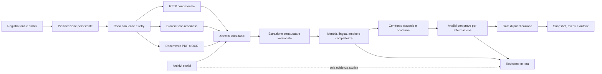

# PolicyWatcher: progetto della prossima major del motore

Data: 31 ottobre 2026. Stato: architettura obiettivo, implementata per incrementi nella preview locale descritta in [engine-v6-implementation-2026-10-31.md](../reports/engine-v6-implementation-2026-10-31.md). Le funzionalità elencate qui restano proposte quando la matrice di implementazione non le dichiara completate. Non è una release pronta, un calendario approvato o una promessa di accuratezza.

Decisioni dell'owner del 31 ottobre: implementazione locale verificata autorizzata; affidabilità e copertura precedono velocità e costo; fino a 500 policy con controllo giornaliero; riuso di Hostinger/VPS e valutazione dei servizi aggiuntivi necessari con budget mensile esplicito; pubblicazione automatica soltanto con evidenze complete, revisione umana per dubbi o alto impatto. Le revisioni successive usano Gemini 4 High nella tab Vivaldi predisposta e GLM 5.3 Max nell'app ZCode. Nessun deploy o acquisto di servizi è incluso nell'implementazione locale.

La [diagnosi](../reports/engine-audit-2026-10-31.md) identifica difetti riprodotti e limiti delle evidenze. Il nome provvisorio della linea di lavoro è **PolicyWatcher 6 — Document Evidence Engine**; il numero non viene applicato al prodotto finché perimetro e gate non sono concordati.

## Risultato atteso

Ogni documento selezionato deve avere un esito persistente e comprensibile. Un recupero HTTP riuscito, una copia storica, un testo completo, una variazione stabile e un giudizio AI supportato devono essere osservabili separatamente. Il motore deve riprendere dopo interruzioni, distribuire il lavoro fra fonti, evitare tentativi inutili e pubblicare soltanto ciò che supera i gate pertinenti.



## 1. Modello di stato

La base esiste in `ScrapeResult.outcome` e nel pacchetto `adaptiveAcquisition`: evolvere questi contratti, le catture immutabili, il replay e lo shadow esistenti. La major aggiunge pianificazione durevole, integrazione obbligatoria degli esiti nei consumatori, identità/completezza documentale più forte e gate sulle affermazioni. Non introduce un motore parallelo che mantenga una seconda interpretazione di live, storico o idoneo.

Evitare un unico booleano `ok`. Il risultato di acquisizione contiene dimensioni separate e un verdetto derivato dalla policy di pubblicazione.

```ts
type DocumentObservation = {
  runId: string;
  taskId: string;
  sourceId: string;
  documentScopeId: string;
  acquisitionId: string;
  artifactId: string | null;
  transport: 'received' | 'failed' | 'not_modified';
  currency: 'live' | 'historical' | 'unknown';
  identity: 'matched' | 'mismatched' | 'unknown';
  completeness: 'complete' | 'partial' | 'unknown';
  comparison: 'unchanged' | 'candidate' | 'confirmed' | 'ineligible';
  analysis: 'not_needed' | 'queued' | 'supported' | 'needs_review' | 'failed';
  terminalReason: string;
  observedAt: string;
};
```

“Complete” significa che uno specifico contratto di fonte è stato soddisfatto; non certezza universale. Stato e versione del contratto sono conservati. L'UI espone il controllo effettuato e ciò che resta ignoto.

Contatori riconciliati:

- `selected = queued + running + completed + cancelled` per le unità pianificate.
- Ogni record completato ha esattamente un esito di confronto terminale; gli stati dell'analisi sono una dimensione separata.
- Record, fonti/varianti uniche, acquisizioni, strategie, tentativi HTTP, redirect, retry, byte e costo sono contatori distinti.
- Fonti live verificate, solo storiche, parziali, bloccate e da revisionare non si sommano in un generico “successo”.
- `lastAttemptAt`, `lastVerifiedAt`, `lastChangedAt`, `nextDueAt` hanno significati diversi. Un errore aggiorna il tentativo, mai l'ultima verifica.

## 2. Pianificazione e worker durevole

Il comando admin crea un `ScanRun` e unità di lavoro, restituisce l'identificativo, e legge il progresso da storage. La coda sopravvive al processo web e alla chiusura del browser.

**Topologia iniziale proposta:** Next.js conserva UI, autenticazione e autorità sulle scritture; il VPS esegue acquisizione/rendering e, se necessario, conversione documenti. Se il database rimane SQLite sull'host applicativo, il worker non apre il file remoto: usa endpoint interni limitati per claim, heartbeat e consegna. Le transazioni e il confronto di ownership restano sul lato che possiede il database. Alternativa di crescita: database PostgreSQL condiviso e consumer con locking per riga. La scelta definitiva dipende da servizio persistente, rete, backup e budget disponibili.

Ogni task ha `stage`, `inputDigest`, `attempt`, `leaseToken`, `leaseExpiresAt`, `nextAttemptAt`, `deadlineAt` e `maxAttempts`. Il completamento aggiorna la riga soltanto se task, token e versione attesa corrispondono. Un worker scaduto può conservare un artefatto diagnostico, ma non modificare la baseline o pubblicare.

Chiavi di idempotenza includono fonte, rappresentazione, osservazione e versione dello stadio. Lo stesso lavoro ritentato non crea una seconda osservazione indipendente. L'outbox viene scritta nella stessa transazione dell'evento pubblicabile; invio notifiche e webhook ha deduplica e retry separati. Nessuna promessa di “exactly once” per sistemi esterni senza supporto della destinazione.

Concorrenza iniziale conservativa da qualificare: pochi host in parallelo, una richiesta attiva per origine, renderer con slot e memoria limitati; analisi AI su coda separata. Token bucket, Retry-After, backoff con jitter e circuit breaker sono persistenti per origine. I task sospesi in revisione hanno pianificazione distinta e non monopolizzano il batch.

I candidati hanno una scadenza e una priorità di riconferma esplicite, con budget riservato anche alla copertura delle altre fonti. Registrare l'instabilità degli hash e i cambi di trasporto/profilo; un candidato che oscilla richiede diagnosi, non retry illimitati. La modalità silenziosa delle notifiche non è un filtro dei candidati né una modalità di osservazione senza pubblicazione.

## 3. Acquisizione selettiva

Un `SourceProfile` versionato descrive URL approvato, eventuali alias verificati, rappresentazione richiesta, percorso atteso, documento/ambito, lingua, formato, strategia preferita e readiness.

- HTTP condizionale per fonti con validatori affidabili. Conservare i campi necessari di ETag, Last-Modified e Vary e l'artefatto a cui si riferiscono. Un 304 senza artefatto integro o con profilo cambiato richiede recupero completo.
- HTTP/2 quando il problema è compatibile con il protocollo; evitare di ripetere automaticamente HTTP/1 e HTTP/2 per una SPA già qualificata.
- Browser su fonti che lo richiedono, con criteri di presenza e stabilità del documento, deadline totale e motivo di incompletezza. L'assenza di traffico non basta.
- PDF ufficiali o alternative ufficiali collegati alla fonte come candidati; confronto di identità, lingua e ambito prima di attivare una sostituzione.
- Archivi in un percorso storico indipendente. Non azzerano un incidente live e non vengono consumati dal gate di conferma live.
- Nessun cambio autonomo di URL canonico, regione o privilegi di accesso sulla sola proposta di un modello.

Il router apprende inizialmente da contatori verificati e regole esplicite. Il costo per ottenere un documento idoneo guida la scelta; non la semplice frequenza di HTTP 200. Ogni preferenza ha scadenza e una quota limitata di rivalutazione. Una ricetta proposta rimane candidata fino a replay, campione indipendente, shadow e attivazione tracciata.

## 4. Artefatti e identità documentale

Separare `FetchIdentity` da `DocumentScope`: il fetch può ignorare il frammento, ma l'estrazione deve conservarlo. Non normalizzare `www`, path o query semantiche senza un'equivalenza dimostrata. Header di rappresentazione, lingua, regione e profilo browser entrano nell'identità; non si registrano credenziali nei log.

Per ogni cattura conservare hash, origine, URL richiesto/finale, catena redirect, tempi, content type, status, header consentiti e dimensioni. Distinguere bytes originali, HTML decodificato, DOM renderizzato, PDF originale, testo OCR e testo normalizzato. Conservare la versione del converter/browser/parser e il legame fra gli artefatti. Una conversione ripetibile del DOM non equivale a poter riprodurre l'intera sessione browser.

Storage tramite interfaccia content-addressed: filesystem privato nel prototipo, object storage solo se giustificato operativamente. Retention e tetto spazio vanno concordati. Mai eliminare un artefatto ancora necessario alla verifica di una baseline o di un cambiamento pubblicato senza una policy esplicita e un indicatore di evidenza non più disponibile.

Il contratto attuale `RawCapture` e lo storage immutabile costituiscono la base: introdurre tipi e versioni per byte originali/PDF e relazioni fra conversioni, con lettura compatibile delle catture precedenti. L'attuale acquisizione opt-in senza fetch aggiuntivo rimane utile; la sua promozione a componente operativo richiede retention, recupero dagli errori e capacità misurate. Conservare il replay di ricette circoscritte e l'assenza di promozione automatica.

## 5. Estrazione, completezza e migrazione parser

Produrre una rappresentazione strutturata con sezioni, paragrafi, liste, tabelle, note, pagina PDF e span testuali. I blocchi hanno identità stabile entro il documento. La deduplica elimina sovrapposizioni tecniche, non tutte le clausole testualmente uguali in sezioni diverse.

Il controllo di identità considera titolo, tipo di documento, provider, lingua, ambito, link ufficiale e segnali di versione. Il controllo di completezza considera sezioni attese, terminali, link al documento integrale, pagine PDF, testo incorporato, troncamenti e contenuto nascosto. Dove mancano prove lo stato è unknown; i marker restano un controllo preliminare, non il verdetto finale.

Valutare un estrattore alternativo come confronto indipendente sul medesimo artefatto. Disaccordo o coincidenza fra estrattori sono segnali diagnostici, non verità. Per PDF complessi/OCR, Docling è un candidato da misurare contro `unpdf`, con isolamento, limiti di risorse e span pagina/testo.

Separare tre impronte: build distribuita, implementazione della trasformazione e configurazione della fonte. Il lockfile completo resta provenienza del build, ma una libreria UI aggiornata non deve da sola cambiare la comparabilità dell'estrazione. I componenti che influenzano effettivamente la trasformazione restano versionati.

Per un cambio parser, rieseguire vecchio e nuovo parser sulla medesima cattura congelata; poi confrontare la nuova cattura con la baseline equivalente. Se manca il vecchio input: stato `baseline_gap`, evidenza vecchia preservata, revisione guidata e nuova baseline esplicitamente approvata. Il sistema non deve dichiarare “nessuna variazione” durante un intervallo non confrontabile.

## 6. Confronto e conferma

Prima confronto deterministico a livello di documento e clausola: aggiunta, eliminazione, modifica, spostamento, formattazione e rumore. Numeri, scadenze, negazioni, soggetti, obblighi, eccezioni e ambiti devono rimanere visibili. L'LLM non determina da solo l'esistenza della differenza testuale.

Il candidato deve citare baseline, versione parser, scope e osservazioni live distinte. La seconda osservazione non è il retry dello stesso task, la cache della prima o una copia d'archivio. La distanza temporale minima è configurabile per fonte e frequenza richiesta, da concordare. Qualsiasi cambio di hash, ambito, provenienza o profilo pertinente resetta la conferma.

Hash identico certifica stabilità della rappresentazione acquisita, non assenza di cambiamenti in documenti esterni incorporati o collegati. Questi devono entrare nel contratto di completezza se sono parte della policy monitorata.

## 7. Analisi con prove e astensione

L'analisi riceve il diff strutturato più le clausole contestuali necessarie. Un registro di copertura rende espliciti tutti i blocchi cambiati processati. Le dipendenze e i rinvii possono richiedere ulteriore contesto; l'ottimizzazione per clausole non deve reintrodurre tagli silenziosi.

Output per affermazione: tipo di cambiamento, significato, ambito, evidenze old/new con versione e span, grado di supporto, incertezze e azione proposta. Nessun numero fisso di rischi o raccomandazioni: zero è valido. `not_applicable` e `not_assessed` sono esiti normali. Score e spiegazioni devono avere una rubrica versionata; non rappresentano compliance legale accertata.

Validazione multilivello: schema; validità degli span; appartenenza alla versione corretta; coerenza numerica e delle negazioni; distinzione vecchio/nuovo; supporto della conclusione; ambito. Le citazioni inventate non vengono solo rimosse lasciando il giudizio pubblicabile. Affermazioni non supportate restano private o sono escluse dal risultato pubblico.

Le date hanno un tipo esplicito: pubblicazione, ultimo aggiornamento, entrata in vigore, accettazione e osservazione. L'analisi non converte automaticamente l'una nell'altra. Il caso AWS O1 della diagnosi entra nel corpus come regressione reale di attribuzione temporale, insieme alla distinzione fra nuova formulazione esplicita e obbligo già esistente.

Un modello più forte interviene sui casi ambigui secondo criteri misurabili. Un secondo modello può contestare il risultato; non può sostituire la fonte né certificare per voto. Confrontare candidati sullo stesso corpus congelato e conservare modello esatto, impostazioni, schema, prompt, token, costo, timeout, fallback e output. L'analisi AI fallita non richiede una nuova acquisizione del documento già congelato.

I documenti esterni sono input non affidabili: istruzioni contenute nelle policy non concedono strumenti, autorizzazioni o modifiche alla pipeline. Le fasi di interpretazione non hanno accesso a segreti o azioni di pubblicazione.

## 8. Pubblicazione e UI operativa

Pubblicazione separata da recupero e analisi. Gate esplicito su live/current, identità, completezza, comparabilità, conferma e supporto delle affermazioni; revisioni richieste per classi concordate. L'interfaccia distingue “cambiamento testuale confermato”, “analisi pronta”, “revisione necessaria” e “pubblicato”. Una revisione tardiva non deve perdere la cattura osservata.

Il Cron Manager mostra una riga per record pianificato, una timeline degli stadi, motivi operativi leggibili, runtime reale e collegamenti alla prova. Le azioni contestuali portano a baseline review, revisione ambito, fonte alternativa o retry previsto. Il riepilogo mostra quanti documenti sono verificati nell'intero inventario e l'età dell'ultima evidenza per classe, non solo il batch appena eseguito.

Le notifiche vengono generate da un evento pubblicabile e inviate attraverso outbox. Importazioni storiche, aggiornamenti parser e rebaseline non producono automaticamente comunicazioni di cambiamento del provider.

## 9. Benchmark e gate

Non usare il numero di test o l'accordo fra modelli come accuratezza del prodotto.

| Livello | Prova | Gate proposto |
| --- | --- | --- |
| Contabilità | Esiti, eventi e record persistiti | 100% delle unità riconciliate; nessun hold omesso |
| Durevolezza | Crash, lease scadute, retry duplicati e risultato tardivo | Nessuna perdita silenziosa; nessun commit da worker scaduto; nessun duplicato pubblicato |
| Sicurezza delle evidenze | Archivi, scope errato, CAPTCHA, input corrotto, parser upgrade | Nessuna promozione a live/pubblicabile nei casi negativi obbligatori |
| Copertura operativa | Tutte le 113 policy correnti, aggregate per variante/fonte | Ogni fonte tentata entro la finestra concordata oppure sospensione esplicita con causa |
| Estrazione reale | Corpus catturato e annotato da revisore, incluse sezioni obbligatorie e boilerplate vietato | Nessuna regressione sui documenti critici; precision/recall per lingua/formato con denominatori |
| Cambiamento | Coppie annotate: sostanziale, rumore, parser, scope, non decidibile | Misurare precision e recall separatamente; astensione visibile; zero incidenti critici nel set di rilascio |
| Analisi | Claim e citazioni annotate, vecchio/nuovo e ambito | Nessuna affermazione materiale pubblicata senza il supporto richiesto dalla rubrica |
| Prestazioni | Stesso inventario e finestre comparabili | Confrontare p50/p95, tentativi, browser-secondi e costo per documento idoneo; soglie economiche da concordare |

Il corpus iniziale deve coprire l'intero inventario come censimento di identità e tutti i tipi di errore noti. Per la valutazione semantica iniziale, selezionare almeno 30 documenti positivi indipendenti e 10 negativi/ambigui, distribuendoli fra aziende, formati e lingue. Sono minimi di pilot proposti, insufficienti per promesse generali. Raggruppare versioni e mirror prima dello split; separare fonti di tuning e holdout; doppia annotazione con adjudication per i casi critici. Riportare numerosità, intervalli di incertezza e mancanti, mai rimuovere dal denominatore i risultati non prodotti.

Eseguire shadow su tutte le fonti selezionate per almeno tre finestre complete iniziali, senza dichiararle sufficienti per efficacia annuale o eventi rari. Nessun secondo fetch necessario quando si confrontano estrattori sullo stesso corpo; routing e disponibilità richiedono invece una prova di rete distinta.

## 10. Incrementi implementabili

| Incremento | Consegna | Prova di chiusura |
| --- | --- | --- |
| M0 — misura corretta | Correggere D1–D4, D6 e D8; esiti completi dopo commit, avanzamento batch, storico/live separati, linkage e baseline gap leggibile | Le riproduzioni diventano test di regressione con aspettativa corretta; inventario e notifiche invariati salvo stati espliciti |
| M1 — lavoro durevole | Tabelle task/attempt/outbox e contratti claim/heartbeat/complete, progresso da DB, fencing e idempotenza | Crash/retry/tardivi su SQLite locale e topologia di staging; nessun live deploy implicito |
| M2 — recupero efficiente | Profili fonti, HTTP condizionale, budget per host, routing renderer e readiness | Pilot reale comparabile, nuove catture archiviate, distribuzioni tempi/costi |
| M3 — documento strutturato | Artefatti e AST, completezza, lingua/ambito, replay parser, PDF e OCR selettivo | Corpus reale annotato e holdout; migrazione reversibile con vecchie evidenze conservate |
| M4 — analisi verificabile | Diff per clausola, coverage ledger, claim gate, astensione, coda AI e benchmark modelli | Test numeri/negazioni/ambito, errori di citazione bloccati, resa bilingue verificata |
| M5 — qualificazione | Canary, restore drill, UI operativa, runbook, compatibilità API/mobile/export | Evidenza di staging e produzione limitata, criteri di stop e rollback verificati |

Il difetto D7 non deve aspettare il completamento dell'intera AST: prevedere una correzione mirata della fedeltà delle tabelle dopo M0, qualificata su catture congelate. Cambia la trasformazione del documento, quindi richiede una nuova versione del parser e il relativo replay; non può essere rilasciata come modifica invisibile né applicata con una rebaseline indiscriminata. M3 generalizza questa protezione a tutti i formati e alla struttura documentale.

Moduli suggeriti: `scan/planner`, `scan/taskStore`, `scan/workerProtocol`, `acquisition/router`, `acquisition/httpCache`, `evidence/artifactStore`, `extraction/documentModel`, `extraction/contracts`, `comparison/clauseDiff`, `analysis/claimValidator`, `publication/gate`, `publication/outbox`. Sono confini di responsabilità, non servizi da distribuire tutti separatamente.

Migrazioni additive. Preservare `Policy`, snapshot e ID pubblici; introdurre tabelle senza riscrivere in massa le evidenze esistenti. Il backfill registra ciò che è ricostruibile e marca gli unknown. Nessun “backfill” inventa HTML originario, giurisdizione, hash della richiesta o citazioni mancanti.

## 11. Rollout e rollback

1. Congelare versione di codice, configurazione e dataset di qualificazione. Identificare l'artefatto effettivamente distribuito prima del primo rilascio.
2. Correzione M0 indipendente dalla sostituzione del motore. Backup e restore verificabili prima delle migrazioni.
3. Nuova pipeline in modalità osservazione; output privati e confronto con baseline sul medesimo artefatto quando possibile.
4. Canary per fonte con attivazione tracciata. Un solo percorso possiede l'autorità di pubblicare e aggiornare la baseline.
5. Espansione soltanto dopo revisione degli scarti e metriche adeguate alla finestra osservata.
6. Rollback disabilita nuove assegnazioni, fa scadere/chiude le lease, conserva artefatti e stato dei task, ripristina il worker compatibile. Mantiene le guardie di comparabilità; se necessario sospende gli scan invece di aggirarle. Le migrazioni additive restano leggibili. Non cancella eventi già inviati: eventuali correzioni hanno un percorso dedicato.

Le revisioni Gemini e GLM servono a contestare progetto e implementazione. Per qualificare ogni incremento servono anche test eseguiti e prove sul sistema corrispondente; il solo parere dei modelli non chiude i gate.
