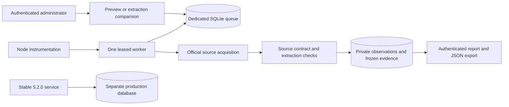

# Engine 6 hosted private preview

Owner choice, 1 November 2026: provide an online 6.0 Preview in a separate environment. The public stable service remains 5.2.0. This is authorization for a private trial, not Engine 6 publication or a production promotion.

## Execution boundary

- Target: existing `https://staging.policywatcher.online`, administrator authentication on pages, APIs, feeds, RSC and prefetch requests. The preview artifact remains private even if its opt-in flag is missing. Search indexing and response caching are disabled.
- Dedicated database: `/home/u847874844/domains/staging.policywatcher.online/policywatcher-preview/preview.db`. Canonical path, existing file and single filesystem link are required. The local production-mode rehearsal uses only `output/engine-channels/hosted-preview/preview.db`.
- `NODE_ENV=production`, `POLICYWATCHER_DEPLOYMENT_TARGET=staging`, matching `APP_URL` and `NEXT_PUBLIC_APP_URL`; `POLICYWATCHER_HOSTED_PREVIEW=1`, `POLICYWATCHER_ENGINE_V6=1`, `POLICYWATCHER_ENGINE_CHANNELS=1`, publication and notifications explicitly `0`.
- Only `preview` or `compare`, observation mode, silent notification mode and batches of at most 50. Stable scans, scheduler entrypoints and unrelated legacy mutations are unavailable here. The main stable service remains a separate destination.
- A source without a reviewed contract remains held. A completed run is not proof that all sources were retrieved or qualified. Comparison applies two extractors to one captured response and does not compare acquisition or AI models.

The worker imports no outbox delivery. Every task claim and commit is fenced by both its task lease and the current worker leadership token. A 90-second leadership lease is renewed every ten seconds; the queue permits at most one active hosted task. A stopped process leaves durable work recoverable after actual lease expiry. The private status API distinguishes process heartbeat, queued work and completed worker steps from source outcomes.

## Build and database preparation

Generate the implementation manifest with `node scripts/engine-implementation-manifest.mjs`. Its canonical file digest list covers engine dependencies, model interfaces, routing guards, worker bootstrap, database schema, dependencies and build controls. `--check` rejects drift. HTTP and worker records use the same bundled identity when runtime source files are absent; packaging and deployed archive hashes must still be verified separately.

Hostinger wraps `next.config.ts` to force standalone output. The canonical configuration now declares standalone explicitly. Before preflight, a normalizer accepts only the observed byte-exact wrapper, checks the renamed base against the immutable manifest, and restores the approved source bytes. Unknown wrappers, modified bases, symbolic links and hard links are rejected. The manifest is never regenerated during deployment.

The managed build calls the shared hosted guard and manifest check before database preparation. A preview release cannot be built for the production target. Instrumentation is excluded during `next build` by both the Next production-build phase and an explicit child-process override.

Bootstrap uses `scripts/engine-preview-bootstrap.ts` with an explicit public-catalog JSON or read-only SQLite source. It creates a fresh dedicated database, imports only allowlisted company/policy fields and bounded reviewed contracts, and writes a receipt. An existing database is never reset or overwritten. Subscriber, session, notification, access-log, run and public-history records are not copied. Prior public baseline text is not a newly verified Engine 6 baseline.

## Operations and recovery

Check `/api/admin/engine` through an authenticated administrator session. Inspect worker heartbeat, implementation identity and oldest queued work before interpreting a run. Configuration or identity errors stop execution; repair the configuration and restart the managed process. Do not substitute the legacy CLI worker for the instrumentation-owned hosted worker.

Retain the prior stable staging archive and database. Staging currently serves the private trial; a later content-only release must explicitly restore and verify that trial after any temporary use of staging for stable-site validation. Never promote the 6.0 Preview archive to `policywatcher.online`.

For rollback, restore the prior staging release/configuration and keep the preview database and receipts outside the extracted release. Do not delete held observations, failed runs or source artifacts to obtain a clean result. Disable new work with the scan-pause control before planned maintenance.

## Qualification limits

This is logical separation within the existing hosting account, not a separate OS or infrastructure security boundary. Resource contention, shared egress, managed-process lifetime without HTTP traffic, storage retention and operation over several days still need observation. The private batch limit is not evidence of capacity for 500 distinct daily sources. The frozen daily cohort remains independent and unchanged by this hosted smoke corpus.

Executed results and reviewer opinions belong in dated reports. Deployment is complete only after the exact archive is current on Hostinger and authenticated live probes confirm worker execution, private captures and unchanged public-state invariants.
