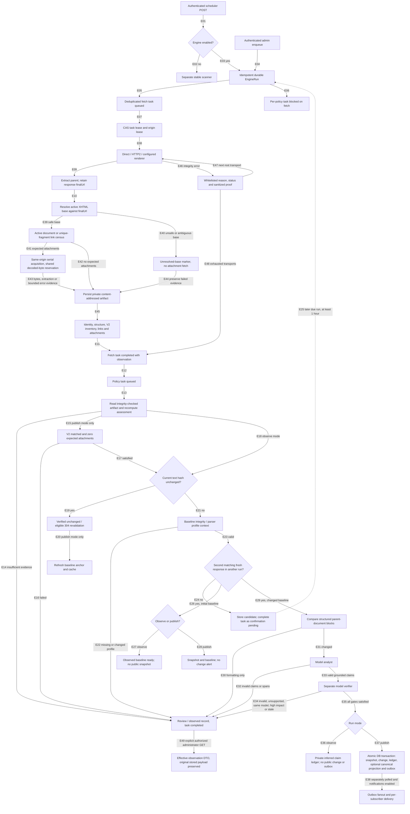
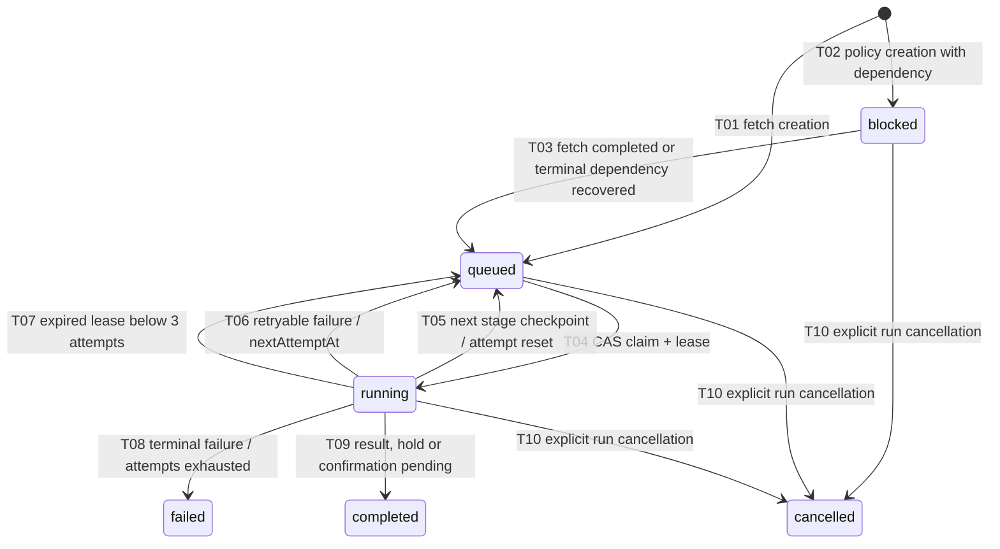
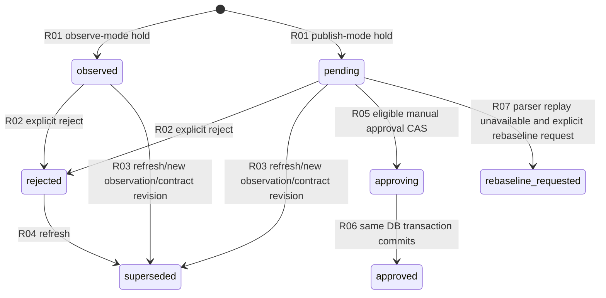
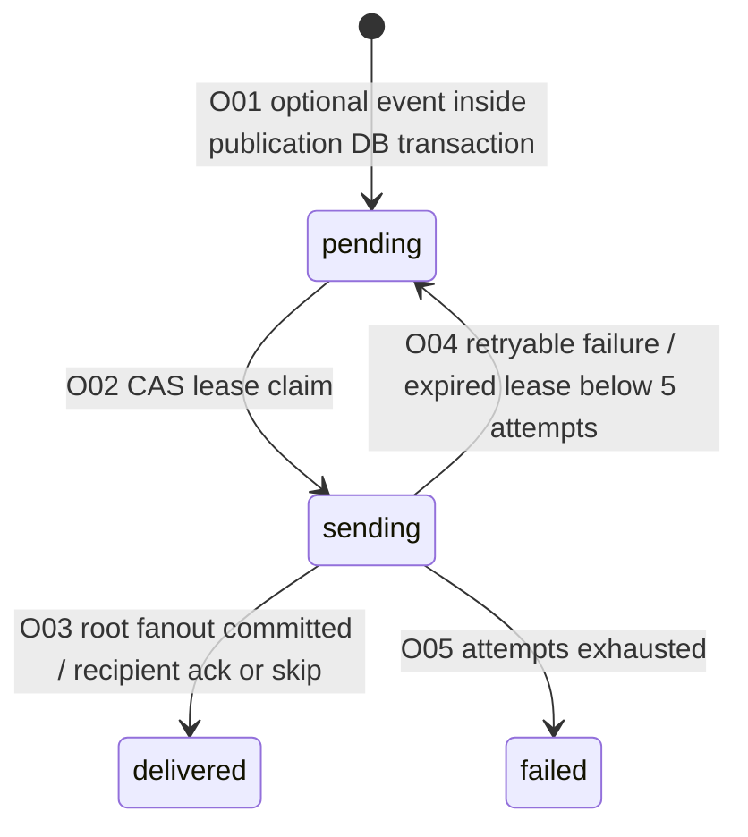
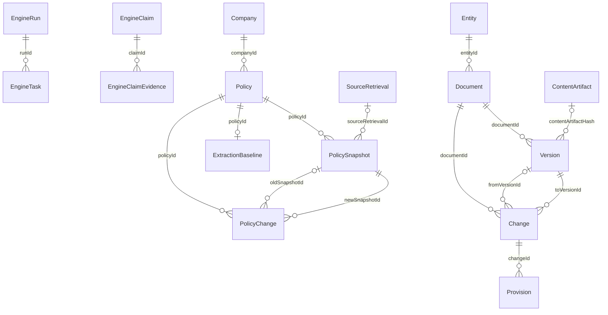
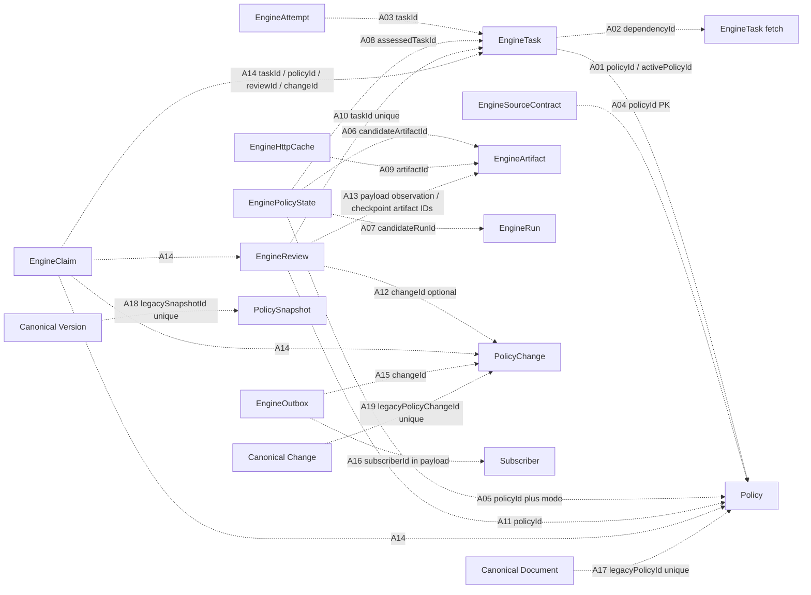

# Workflow diagram specification  -  verified corrected source 3eabf9d

Scope: read-only reconstruction of corrected source; original AS-IS946 and corrected 0b0c515 specifications are preserved separately. Read-only reconstruction of `/Users/fabriziodegni/Projects/PolicyWatcher-reconciliation-20261116`, commit `3eabf9d8b420efb13debfcd8b6e378e81a2c4c61`. No hosting, policies, models, deployment or runtime tests were accessed by this diagram task. Every diagram below describes candidate code, not current hosted behavior or qualification. Matching a reference never authenticates its origin; attachment-bearing policies are observation-only. Branches labelled publish are implemented capability, not authorization to enable them.

## 1. End-to-end flow



### End-to-end edge source map

| Edge | Verified implementation source |
|---|---|
| E01 | `src/app/api/cron/check-all/route.ts:1581-1593`: hosted Preview refuses scheduler, authorization and pause checks. |
| E02 | `src/app/api/cron/check-all/route.ts:1594-1601`: engine-disabled branch invokes `runFullScan`; stable details are intentionally outside this Engine 6 diagram. |
| E03 | `src/app/api/cron/check-all/route.ts:1594-1598`: mode selected by publication env, idempotency header/hour-key, response 202. |
| E04 | `src/app/api/admin/engine/route.ts:63-82`: admin role, engine-enabled, bounded input, mode flag and enqueue. Hosted/channel observe restrictions also `src/lib/engine/store.ts:34-46`. |
| E05 | `src/lib/engine/store.ts:80-99`: exact fetch key includes scope-relevant input, one fetch task per key per run. |
| E06 | `src/lib/engine/store.ts:100-102`: policy reservation, dependency ID and initial blocked state. |
| E07 | `src/lib/engine/store.ts:144-185`: pause/claimability checks, origin cooldown and CAS lease; hosted worker leader and single-active-task checks. |
| E08 | `src/lib/engine/acquisition.ts:249-284`: bounded transport order, backoff, drift and conditional branch. |
| E09 | `src/lib/engine/acquisition.ts:285-289`: extract parent, retain actual `result.finalUrl` as `documentUrl`, retain success transport proof. |
| E10 | `src/lib/engine/acquisition.ts:315-331`: active XHTML base resolution; response final URL is default, ambiguous/unsafe base becomes an unresolved marker. |
| E11 | `src/lib/engine/pipeline.ts:309-320`: observation remains an eligible/ineligible result; selected transient failures retry instead. |
| E12 | `src/lib/engine/store.ts:248-256`: fetch completion clears lease and queues blocked dependents. Failed dependencies also wake via `129-131,307-310`. |
| E13 | `src/lib/engine/pipeline.ts:142-152`: fetch result, private artifact read and recomputed capture assessment. |
| E14 | `src/lib/engine/pipeline.ts:147-152,92-120`: hard hold; review record and completed task are distinct from success. |
| E15 | `src/lib/engine/pipeline.ts:153-155`: additional publication coverage gate. |
| E16 | `src/lib/engine/coverage.ts:199-204`, `src/lib/engine/pipeline.ts:153-155`. |
| E17 | `src/lib/engine/pipeline.ts:153-158`: after publication gate, current context and current hash are checked. |
| E18 | `src/lib/engine/pipeline.ts:153-158`: observe mode skips the publication-only gate, but not capture eligibility. |
| E19 | `src/lib/engine/pipeline.ts:158-171`: unchanged path; no second capture or inference is required here. |
| E20 | `src/lib/engine/pipeline.ts:162-164,123-127`: only publish run refreshes authoritative baseline/cache. |
| E21 | `src/lib/engine/pipeline.ts:173-179`: changed hash; a 304 cannot confirm change. |
| E22 | `src/lib/engine/pipeline.ts:174-190`: missing anchor or parser-profile change routes to review/replay, rather than directly to inference. |
| E23 | `src/lib/engine/pipeline.ts:192-223`: existing assessed-key reuse branch exists before confirmation; see caution below. |
| E24 | `src/lib/engine/pipeline.ts:224-235`: complete this task, schedule policy state for later capture. |
| E25 | `src/lib/engine/store.ts:74-91`, `src/lib/engine/pipeline.ts:220-233`; confirmation requires different run, same document+transport profile, 1 hour to 7 days. No timer here automatically enqueues that run. |
| E26 | `src/lib/engine/pipeline.ts:238-250`: two captures can establish a baseline. |
| E27 | `src/lib/engine/pipeline.ts:241-248`: private readiness only. |
| E28 | `src/lib/engine/pipeline.ts:243-246,129-139`: authoritative baseline plus optional canonical projection when dual-write is enabled, no PolicyChange/outbox creation on this branch; `src/lib/documentEvidenceSync.ts:485-491` supplies the conditional helper. |
| E29 | `src/lib/engine/pipeline.ts:252-260`: verify stored baseline hash, compare and checkpoint. |
| E30 | `src/lib/engine/pipeline.ts:256`: formatting requires baseline review. |
| E31 | `src/lib/engine/pipeline.ts:257-265,325-327`: parent old/new structured documents and deltas, analyst call outside DB transaction. |
| E32 | `src/lib/engine/pipeline.ts:328-329`, `src/lib/engine/claims.ts:27-87`: claim schema/spans/change coverage. |
| E33 | `src/lib/engine/pipeline.ts:330-336`: durable stage transition and verifier invocation. |
| E34 | `src/lib/engine/pipeline.ts:338-343`, `src/lib/engine/claims.ts:90-113`: verdict, resolved model identity, high impact and 48-hour evidence age. |
| E35 | `src/lib/engine/pipeline.ts:344-350`: re-read evidence, publication coverage recheck and fenced current-policy CAS. |
| E36 | `src/lib/engine/pipeline.ts:350-358`, `src/lib/engine/claimLedger.ts:48-57`: private ledger inference status, no public effect. |
| E37 | `src/lib/engine/pipeline.ts:268-295,348-359`, `src/lib/engine/store.ts:198-217`, `src/lib/documentEvidenceSync.ts:485-491`: atomic DB effects, canonical projection only when dual-write is enabled, no network in fenced work. |
| E38 | `scripts/engine-worker.ts:18-21`, `src/lib/engine/outbox.ts:10-64`: standalone worker polls notification outbox separately. Hosted Preview worker does not run outbox. |
| E39 | `src/lib/engine/acquisition.ts:332-345`: active nodes, exact fragment scope and resolved HTTP(S)/mailto/tel links; inert template content excluded by active-tree predicate. |
| E40 | `src/lib/engine/acquisition.ts:319-331,353-360`: unsafe or multiple active bases produce `unresolved_document_base`; required links cannot match, so no attachment request is issued. |
| E41 | `src/lib/engine/acquisition.ts:348-360`: V2 manifest, same-origin and exact expected link occurrence count. |
| E42 | `src/lib/engine/acquisition.ts:290-292,350-351`: no declared attachments returns immediately; root artifact still retained and assessed. |
| E43 | `src/lib/engine/acquisition.ts:362-394`: a shared per-acquire reservation admits bounded attachment requests and retains successes or bounded failures. |
| E44 | `src/lib/engine/acquisition.ts:290-292,353-360`: failed/no-fetch attachment expectations and unresolved link census remain in retained parent evidence and fail assessment. |
| E45 | `src/lib/engine/acquisition.ts:221-227,291-295`; `src/lib/engine/document.ts:131-149`; `src/lib/engine/coverage.ts:171-197,272-320`: recomputed hard evidence assessment after immutable write. |
| E46 | `src/lib/engine/acquisition.ts:258-260,398-424`: preserve bounded status/reason/proof from TransportIntegrityError; generic exceptions expose only transport_failed/status 0. |
| E47 | `src/lib/engine/acquisition.ts:252-260`: continue bounded root fallback order after error; attachment request promises/reservation are shared across those fallbacks. |
| E48 | `src/lib/engine/acquisition.ts:309-311`: no usable candidate returns ineligible live_source_unverified with final bounded status and retained diagnostics. |
| E49 | `src/app/api/admin/engine/route.ts:26-41`, `src/app/admin/engine/page.tsx:15-16,120,180-183`: explicit protected read resolves direct or terminal-checkpoint observation, returns a separate effective observation DTO and renders its timestamp/source/status without rewriting the stored payload. |

Caution for renderer: the `state.assessedKey` branch can reuse a recent completed semantic assessment and finish as `assessment_already_recorded` without new analyst/verifier calls (`pipeline.ts:192-213`). It does not refresh semantic approval or its original evidence timestamp. Add a compact bypass node or footnote to the comparison area when rendering a detailed diagram.

## 2. States: keep stage, status, outcome and review separate

### Task status machine



| State edge | Source |
|---|---|
| T01/T02 | `src/lib/engine/store.ts:95-102`. |
| T03 | `src/lib/engine/store.ts:129-131,253-256,307-310`. |
| T04 | `src/lib/engine/store.ts:171-185`; lease 5 minutes at `10`; heartbeat `226-231`. |
| T05 | `src/lib/engine/store.ts:259-265`; policy stage order `pipeline.ts:323-338`: evaluate → analyze → verify → commit. Fetch stage stays acquire. |
| T06 | `src/lib/engine/store.ts:296-310`: attempts below 3 and retryable reason; exponential backoff min 2 minutes for first claimed attempt, capped at 1 day. |
| T07/T08 | `src/lib/engine/store.ts:115-126,296-306`: owner/generation/expiry guarded updates; terminal failure may create review. |
| T09 | `src/lib/engine/store.ts:248-252`; hold also calls finishTask `pipeline.ts:119`, pending confirmation `234`. |
| T10 | `src/lib/engine/store.ts:325-340`: preserve evidence, fence workers and release reservations. |

`EngineRun`: queued → running when a task is claimed (`store.ts:77-79,185`); when no active tasks remain → completed or completed_with_errors according to failed task count (`315-322`); cancellation → cancelled (`325-340`). A run with review holds can be completed and still unqualified: task completion is processing completion, not a green-source denominator.

### Review state machine



R01 `pipeline.ts:92-119` and `store.ts:282-290`; R02/R03/R04 `pipeline.ts:486-498`, superseding new holds `107-109`, contract edits `api/admin/engine/route.ts:93-101`; R05/R06 `pipeline.ts:415-449,452-484`. Approving is an intermediate state in the transaction; rollback prevents a half-approved commit. R07 `pipeline.ts:386-412` first rechecks capture eligibility and the same publishable-reference/zero-attachment gate (`398-400`), then updates sourceMigrationPending and schedules future acquisition, does not adopt/publish immediately. Two fresh captures are still required. No dedicated rebaseline-request revoke action is defined here.

### Outbox state machine and delivery meaning



O01 `pipeline.ts:291-292`; O02 `outbox.ts:17-23`; O03 root fanout `32-44`, subscriber send/consent skip and final mark `46-58`; O04 `13-16,59-62`; O05 `13-14,60-62`. **Root delivered means fanout committed, not email received.** A subscriber row may be finalized without SMTP if consent/preferences no longer match (`46-55`). Unique event keys support idempotent DB fanout (`39-41`, schema `195-208`). SMTP can be attempted again after acknowledgement/DB-mark interruption; stable Message-ID (`53`) does not prove exactly-once inbox delivery.

## 3. Sequence and transaction boundary

```mermaid
sequenceDiagram
  participant Entry as Authenticated entry
  participant DB as Database
  participant W as Durable worker
  participant Source as Policy origin / renderer
  participant A as Analyst model
  participant V as Verifier model
  participant N as Outbox worker
  participant SMTP as Mail provider
  Entry->>DB: S01 enqueue run, fetch and blocked policy tasks
  Entry-->>Entry: S02 202 accepted, no scan execution in request
  W->>DB: S03 claim task / origin lease / hosted leader fencing
  W->>Source: S04 bounded acquisition outside DB transaction
  Source-->>W: S05 response or eligible 304; optional same-origin attachments
  W->>DB: S06 immutable artifact + fetch result; queue policy dependent
  W->>DB: S07 integrity read, assessment and candidate confirmation
  Note over W,DB: Different run, same candidate/profile, 1 hour to 7 days; first task completes
  W->>A: S08 analyze old/new parent evidence outside transaction
  A-->>W: S09 claims, exact span validation
  W->>DB: S10 checkpoint analyze-to-verify
  W->>V: S11 verify grounded claims outside transaction
  V-->>W: S12 verdicts + resolved identity
  W->>DB: S13 commit checkpoint; revalidate gates
  alt Observe or any hold
    W->>DB: S14 private state/review/validated claim ledger; no public change
  else Publish, zero expected attachments, all gates satisfied
    rect rgb(225,240,235)
      W->>DB: S15 one fenced transaction: CAS context, snapshot, baseline, change, claims, optional canonical projection and outbox, task completion
    end
    N->>DB: S16 separate claim and root fanout transaction
    N->>SMTP: S17 per-recipient send outside publication transaction
    SMTP-->>N: S18 acknowledgement
    N->>DB: S19 mark delivered or retry under lease
  end
```

S01 `store.ts:62-105`; S02 scheduler `api/cron/check-all/route.ts:1594-1598`, admin `api/admin/engine/route.ts:75-82`; S03 `store.ts:144-185,198-217`; S04/S05 `acquisition.ts:236-311,348-394`; S06 `store.ts:234-256`, `pipeline.ts:309-320`; S07 `pipeline.ts:142-260`; S08/S09 `263-265,325-330`; S10 `store.ts:259-265`; S11/S12 `pipeline.ts:334-343`; S13 `344-347`; S14 `92-120,350-358`; S15 `268-295,348-359`, `store.ts:198-217`, conditional canonical helper `src/lib/documentEvidenceSync.ts:485-491`; S16 `outbox.ts:17-44`; S17/S18/S19 `outbox.ts:46-62`.

The sequence is representative of a changed document after confirmation. Initial baseline, unchanged/304, parser replay, formatting review and assessed-key reuse branches do not necessarily invoke models. Do not present cron as an automatic hourly/day timer: this code accepts invocations and creates nextDueAt metadata; an external scheduler or manual call must enqueue another run. Standalone worker (`scripts/engine-worker.ts:8-22`) and hosted HTTP-process worker (`src/instrumentation.ts:1-12`, `hostedWorker.ts:167-244`) are alternate execution owners. The hosted Preview context is observe/silent with at most 50 selected policies (`store.ts:34-46`) and one active task across processes (`167-169`), and does not call notification delivery.

## 4. Entity relations: actual foreign keys versus application references

### Declared Prisma relations only

This is a selected schema view relevant to the workflow, not all database tables or all foreign keys. Canonical relationships describe declared schema structure; they do not mean canonical rows are projected on every publication. `dualWriteCanonicalPolicyGraph` returns null when its dual-write flag is disabled (`src/lib/documentEvidenceSync.ts:485-491`). When enabled it uses the caller’s supplied transaction (`400-408,485-491`), so those enabled writes share the publication transaction rather than creating a separate global transaction.



| FK edge group | Source |
|---|---|
| EngineRun → EngineTask | `prisma/schema.prisma:12-30`, onDelete Cascade. |
| EngineClaim → EngineClaimEvidence | `prisma/schema.prisma:146-182`, onDelete Cascade. |
| Company → Policy | `prisma/schema.prisma:419-422`, onDelete Cascade. |
| Policy → PolicySnapshot | `prisma/schema.prisma:575-578`, onDelete Cascade. |
| Policy → PolicyChange | `prisma/schema.prisma:597-600`, onDelete Cascade. |
| Policy → ExtractionBaseline | `prisma/schema.prisma:940-949`, onDelete Cascade; policyId is PK. |
| Snapshot old/new → PolicyChange | `prisma/schema.prisma:601-604`: old optional/SetNull; new required/Cascade. |
| SourceRetrieval → PolicySnapshot | `prisma/schema.prisma:586-587`, optional/SetNull. |
| Entity → Document → Version | `prisma/schema.prisma:230-243,259-263`, Cascade. |
| ContentArtifact → Version | `prisma/schema.prisma:270-271`, optional/Restrict. |
| Document → Change; Version old/new → Change | `prisma/schema.prisma:289-297`, old optional/SetNull; new Cascade. |
| Change → Provision | `prisma/schema.prisma:314-318`, Cascade. |

### Scalar/JSON references  -  not declared Prisma FKs



A01/A02 `schema.prisma:27-55`; A03 `65-75`; A04 `77-83`; A05–A08 `85-101`; A09 `113-121`; A10–A13 `123-137`, JSON artifact references populated `pipeline.ts:103-111`; A14 `schema.prisma:146-176`, writes `claimLedger.ts:40-57`; A15 `schema.prisma:195-208`; A16 `outbox.ts:39-46`; A17 `schema.prisma:240`; A18 `277`; A19 `303`.

The private EngineArtifact store is content-addressed JSON with hash/length integrity (`store.ts:234-245`), distinct from canonical public ContentArtifact (a contentHash-keyed text artifact; `schema.prisma:251-257`). Independent inventory V2, links, expected attachment manifests and provenance are inside SourceContract JSON; captured attachment bytes and structured documents are inside the private CaptureBody artifact (`acquisition.ts:10-15,348-391`), not new normalized attachment tables.

## 5. Gate matrix

| Gate | Branch | Required condition / action | Verified source |
|---|---|---|---|
| Entry authorization | scheduler / admin | valid Bearer or admin-role session; hosted scheduler refused | `api/cron/check-all/route.ts:1581-1593`; `api/admin/engine/route.ts:16-20,63-77` |
| Hosted Preview isolation | enqueue / worker | preview/compare channel, observe, silent, limit ≤50; exact implementation context | `store.ts:34-46`; `pipeline.ts:304-308`; `scanChannels.ts:87-100` |
| Pause / publication flags | enqueue, claim, manual approval and hosted fenced context | process-start flags with no live setter; entry/claim and manual approval checks, plus hosted context and leader reassertion at fenced writes; not an instantaneous global kill switch | `store.ts:40,151-155,198-217`; `pipeline.ts:304-308,386-388,415-417`; `hostedWorker.ts:65-69,94-103` |
| Stable/Preview exclusion | enqueue | when experimental channels are enabled, stable active lease blocks Engine run and vice versa | `store.ts:63-66`; `api/cron/check-all/route.ts:125-129` |
| Durable lease fencing | claim / writes | CAS token, generation, unexpired task lease; hosted leader asserted in same DB transaction | `store.ts:163-185,198-223`; `hostedWorker.ts:91-116` |
| Origin pacing | fetch | origin cooldown and origin lease; serial same-origin attachment requests within held fetch lease, with one reservation budget shared by all root fallbacks | `store.ts:156-177,253-255`; `acquisition.ts:348-394` |
| Contract identity | acquisition | exact source URL and language; required title/headings/terminal/size bounds | `acquisition.ts:238-239`; `document.ts:131-149` |
| Transport / drift | retrieval | transport helper acceptance, no source drift; 429/503 backoff; configured renderer only | `acquisition.ts:252-284` |
| Conditional 304 | unchanged only | cached matching baseline/profile, direct/exact URL, cache eligibility; no attachments | `acquisition.ts:240-282`; `pipeline.ts:158-173` |
| Private artifact integrity | artifact read | digest(bodyJson)=ID and byteCount matches; max12 MB on write | `store.ts:234-245` |
| V2 reference coverage | capture and publish | source/language/group counts/order; independently declared V2 elements/link census; candidate ID not reference ID | `coverage.ts:171-204,272-292` |
| Active base and document location | link census / attachment planning | one active XHTML base resolved against actual response finalUrl, otherwise default finalUrl; unsafe or ambiguous base holds without fetching attachments; inert template bases/anchors excluded | `acquisition.ts:216,223,288,315-345` |
| Failure diagnostics | root/attachment transport | whitelisted codes, integer status 0–599, enum/length-validated proof rebuilt without extra properties or raw exception text | `acquisition.ts:258-260,386-424` |
| Reservation budget | all root fallbacks in one acquire | reserve ≤1 MB before request from 2 MB total, retain failed reservations, refund successful unused allowance, reuse request promises; this bounds admitted decoded output, not total wire traffic | `acquisition.ts:249-251,348-394`; `scraper.ts:601-615,750-751,822` |
| Terminal review readability | authenticated admin GET / UI | direct payload observation or checkpoint observation fallback restores retained artifact, coverage and attachment failure evidence; separate effective-observation DTO drives timestamp/source/HTTP display while original payload is preserved | `api/admin/engine/route.ts:26-41`; `src/app/admin/engine/page.tsx:15-16,120,180-183` |
| Reference provenance limit | all coverage | referenceOriginVerified=false and sourceCompletenessQualified=false even on match | `coverage.ts:176,275-276` |
| Attachment capture | observe only | exact links/status/final URL/media; complete origin framing; original entity bytes and reviewed extraction; shared 2 MB decoded-output reservation per acquire, ≤1 MB per file, at most 4 manifest entries; failed reads retain reservation, successful small reads refund unused allowance; in-run promises reused; no redirect targets | `acquisition.ts:348-394`; `coverage.ts:294-317` |
| Attachment publication hold | all publish / approval paths | expectedAttachments must equal zero regardless of a matching inventory | `coverage.ts:199-204`; `pipeline.ts:36-38,153-155,268-269,345-347,398-400,427-428,457-458` |
| Current context | authoritative write | current policy baseline/scope, contract hash, extractor profile and CAS lock unchanged | `pipeline.ts:54-72` |
| Confirmation | initial/changed baseline | fresh response, same hash/profile, distinct run, 1 hour≤spacing≤7 days | `pipeline.ts:173,215-235`; constants `store.ts:12-13` |
| Parser-profile replay | changed text / old profile | retained old input hash valid, re-extract and require explicit baseline review; unsafe replay requires new confirmed rebaseline | `pipeline.ts:174-190,386-412,452-484` |
| Claim grounding | analyze and commit | schema, exact UTF-16 spans, old/new support, complete delta coverage and table context | `claims.ts:27-87`; `pipeline.ts:327-343` |
| Verifier independence | commit / approval | structurally complete supported verdicts; distinct resolved model identities; correlated model errors still possible | `claims.ts:90-113`; `pipeline.ts:339-343,429-432` |
| High-impact / freshness | commit / review | sensitive/high impact needs human review; candidate evidence ≤48 hours | `claims.ts:83-86`; `pipeline.ts:341-343,429-432` |
| Manual approval scope | review | only impact-only or explicit parser/formatting review; missing hard evidence cannot be waived; current context rechecked | `pipeline.ts:415-484` |
| Atomic publication | commit / eligible manual approve | baseline+snapshot+change+claims+optional outbox in one DB transaction; canonical projection participates in that same transaction only when dual-write is enabled, otherwise the helper returns null | `pipeline.ts:268-295,348-359,433-449`; `src/lib/documentEvidenceSync.ts:50-54,400-408,485-491` |
| Notification eligibility | separate outbox | notifications flag, public published change; confirmed active INSTANT subscriber and preferences rechecked at send | `outbox.ts:10-11,25-33,46-58` |
| Notification retries | separate outbox | leased CAS, max5 attempts, stable Message-ID; DB fanout dedup, no exactly-once SMTP guarantee | `outbox.ts:13-23,39-41,49-62` |

## Consistency notes for parent audit

1. **Process configuration boundary, pre-existing design limit:** the code review confirmed no live setter for publication/pause environment flags. Entry/claim and manual approval inspect process configuration (`store.ts:40,151-155`; `pipeline.ts:386-388,415-417`). Hosted fenced writes additionally reassert preview context and leader ownership within the transaction (`store.ts:198-217`; `hostedWorker.ts:65-69,94-103`). This is not a demonstrated new P1 and should not be drawn as an instantaneous global kill switch. A new deployment changes process configuration; it does not introduce a supported live flag-toggle API.
2. **No implicit scheduler loop:** nextDueAt and daily/confirmation intervals are eligibility metadata; a later enqueue invocation is still needed. The hosted worker drains persisted queued tasks and does not create future runs (`hostedWorker.ts:174-196`).
3. **Different denominators:** completed policy tasks include reviews and confirmation-pending outcomes. EngineRun completion, SourceContract/inventory configuration counts and true completeness are different (`store.ts:315-322`; `api/admin/engine/route.ts:56-59`).
4. **Model approval labels:** auto-published claims still get `interpretationStatus=inferred`; only explicit human approval calls `approveClaimLedger` (`claimLedger.ts:48-64`; `pipeline.ts:353-355,441-443`). Public != human-approved.
5. **Label boundary:** `scanChannels.ts:81,94` deliberately/previously labels `stableVersion='5.2.0'`, while current package product version is 5.6.0. Do not silently draw this as current product identity; ask whether it is a stable-scanner protocol ID versus stale presentation metadata. This is not proved a functional bug by this diagram reconstruction.
6. No live deployment, semantic accuracy, full source completeness or 500/day qualification is established by these diagrams.


## Corrected-source detail panels for the interactive atlas

### HTML base, active tree and scope

The root body's `documentUrl` is initialized on extraction and overwritten with the actual final response URL after acquisition (`acquisition.ts:216,288`). Link resolution uses that location by default. Exactly one active XHTML `<base href>` may override it; multiple active bases, unsafe schemes/credentials or an invalid location add an unresolved-base marker and cause inventory/link mismatch (`315-331`). Template document-fragment content is inert: its nodes do not satisfy the active HTML-tree predicate, so inert bases and anchors are not counted (`319-320,332-344`). Fragment policy scopes still use the unique active element matching the declared source fragment (`333-339`).

An unresolved base means expected attachment link counts do not match and no expected attachment fetch is issued (`353-360`). The root evidence is still preserved and can fall back or become a held review; do not draw ambiguity as an automatic corrected URL or an accepted empty attachment list.

### Per-acquire decoded reservation

`attachmentRequests` and `attachmentBudget` are created once before the root-transport loop (`249-256`). Each new exact attachment request reserves `min(1 MB, 2 MB - reserved)` before any call (`364-370`). Its successful actual decoded length refunds unused allowance; an oversized/failed read keeps the reservation because consumed decoded output cannot be assumed zero (`367-373`). Reusing the same promise on a later root fallback spends no new reservation and issues no new network request (`364-376`). Capture-level byte/text checks still apply (`378-382`). Attachment manifest parsing limits entries to four (`coverage.ts:210-218`); `acquireEngineAttachment` enforces the caller's decoded bound inside the bounded pinned body reader (`scraper.ts:601-615,750-751,822`).

This is **not** a 2 MB all-network-traffic cap: compressed wire bytes, failed response traffic and the root document have different transport limits. Label the chart “decoded attachment reservation per acquisition”, not “total bytes downloaded”. Cross-origin attachments stay held, and all attachment-bearing policies remain observation-only irrespective of byte/reference matches.

### Bounded errors and terminal evidence

Root TransportIntegrityError failures retain only a whitelisted code, sanitized HTTP status and validated/reconstructed TransportProof (`acquisition.ts:258-260,398-424`). Unknown errors keep only generic transport_failed/status 0. Attachment integrity failures keep the analogous bounded facts under `attachmentErrors` (`386-392`). The authenticated no-store admin GET resolves either `payload.observation` or terminal `payload.checkpoint.observation`, returns the selected value as a separate `observation` DTO and returns coverage plus bounded attachment errors without returning raw HTML/base64 (`api/admin/engine/route.ts:26-41`). The stored `payload` is preserved verbatim. The UI prefers that effective DTO for observation timestamp, source and HTTP status and has a legacy top-level payload fallback (`src/app/admin/engine/page.tsx:15-16,120,180-183`); the display no longer reports missing metadata merely because a terminal review stored it under checkpoint. These are diagnostics about received/rejected responses, not source-completeness qualification.

### Rebaseline uses the same hard publication scope

`requestConfirmedRebaseline` now reads the retained artifact and calls `publicationCoverageSatisfied` before sourceMigrationPending is changed (`pipeline.ts:397-408`). V1 and attachment-bearing references cannot use a rebaseline request to advance a public source. A legitimate request remains a request for two future fresh confirmations, not an immediate adopted baseline. The existing publication/approval gate remains authoritative (`coverage.ts:199-204`).

## Breve sintesi italiana dei sette diagrammi

1. **Dalla fonte alla decisione.** Collega richiesta autorizzata, coda persistente, acquisizione, inventario atteso e decisione. La base attiva viene risolta sul final URL; i template inerti non entrano nel censimento. Ambiguità e prove insufficienti sospendono il caso senza fetch degli allegati quando la base è irrisolta.
2. **Stati del lavoro.** Distingue task bloccati, in coda, in esecuzione, completati, falliti e annullati. Un task completato può contenere una sospensione o attendere la seconda cattura: completamento non significa fonte qualificata.
3. **Stati della revisione.** Distingue osservazione, revisione pendente, rifiuto, sostituzione e approvazione. Anche una nuova baseline richiede il gate pubblicabile. Il dettaglio terminale mostra la stessa osservazione effettiva per data, fonte e HTTP, preservando il payload originale.
4. **Stati delle notifiche.** Separa creazione dei destinatari, tentativo di invio e ritentativo. Un evento radice consegnato indica fanout registrato, non una email ricevuta. Non viene promessa una consegna SMTP esattamente una volta.
5. **Sequenza operativa e transazione.** Acquisizione e modelli operano fuori dalla transazione; snapshot, modifica, evidenze e l’eventuale coda notifiche vengono salvati insieme. La proiezione canonica partecipa alla stessa transazione solo quando il dual-write è attivo. La riserva degli allegati è condivisa dai fallback e limita l’output decodificato ammesso, non tutto il traffico. Le notifiche seguono separatamente.
6. **Relazioni dichiarate nello schema.** Mostra una selezione delle chiavi esterne dichiarate: run e task, claim e citazioni, policy e snapshot, oltre ai modelli canonici opzionalmente proiettati. Non rappresenta tutte le tabelle e le relazioni dello schema non dimostrano qualità o completezza dei contenuti.
7. **Riferimenti applicativi delle evidenze.** Mostra separatamente identificativi e riferimenti JSON che collegano contratti, artefatti, review, task, ledger e outbox. Le linee tratteggiate rappresentano riferimenti applicativi, non chiavi esterne garantite dal database.
