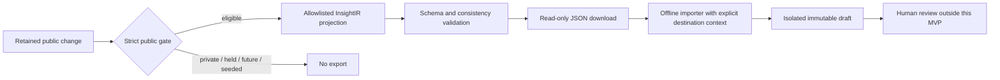

# PolicyAsCode MVP: public observations and isolated drafts

Status: implementation candidate dated 22 November 2026. This document describes the local MVP; it is not a deployment receipt.

## Sintesi per la revisione

PolicyWatcher può rendere gli insight leggibili dalle macchine senza trasformarli automaticamente in istruzioni da eseguire. Il primo passaggio è un contratto JSON versionato: identifica la policy e la cattura, mantiene i riferimenti alle citazioni e dichiara ciò che non è stato verificato. Un importatore separato conserva questo risultato come bozza da revisionare.

La pubblicazione di un cambiamento sul sito non autorizza un'azione nel sistema destinatario. Nell'MVP ogni interpretazione resta `inferred`, la revisione è richiesta, la decisione è `indeterminate` e `executionAuthorized` è sempre `false`. Il formato non qualifica la completezza della fonte, l'accuratezza semantica o la capacità di elaborare 500 policy al giorno.

## Boundaries

The MVP implements a public, read-only export and an offline, draft-only import. It does not add a private Preview export, a remote import endpoint, a rule evaluator, an approval API or an activation path. It does not modify the authoritative spreadsheet, its generated models, the PolicyAsCode runtime database or the existing policy catalogue.

The implementation is a generic contract and adapter. No private corporate model, spreadsheet, policy source or organisation-specific implementation is part of the public integration.



## Read-only producer

The candidate endpoint is `GET /api/v1/insights/{changeId}`. It accepts a UUID path identifier and no query parameters. It has no mutation or private mode. A caller cannot select a tenant, a reviewer, an approval state or additional database fields.

The data query and the projection each enforce the public boundary. A change must have public evidence, an actual publication timestamp no later than the server's comparison time and a public current snapshot. Its policy must be `Available` or `Reviewed` and must not be seeded. The query deliberately does not use the development override that can widen older public-data helpers.

The database selection is explicit. Engine review records, private inference requests and responses, reviewer identities and tenant data are not selected for export. A predecessor is projected only if its own `publicEvidence` flag is true. An interpretation explicitly tied to a private predecessor is omitted, including its statement; its quote or hash is not substituted into another field.

All endpoint outcomes use `private, no-store`, including unavailable records, invalid parameters and service errors. The route does not record raw exceptions or payload-bearing diagnostics. Not-found responses do not distinguish a private record from an unavailable identifier. Rate limiting applies before retrieval and suppresses persistent client-IP logging for this route.

The export is another projection of the stored change used by the human-facing product. It does not ask a model to generate a separate machine summary.

## InsightIR 0.1.0

The portable contract and its JSON Schema are under `integrations/policy-as-code/`. The schema has a closed set of properties and literal observation-only states. The runtime additionally checks digests and relationships that JSON Schema alone cannot establish.

The candidate schema route is `GET /schemas/insight-ir/0.1.0`, matching the schema identifier. It serves only the static contract, with a public cache policy; it is distinct from the non-cacheable insight export. Schema publication is not evidence of a hosted deployment. The schema uses the standard `uri` annotation. The portable runtime additionally enforces canonical HTTPS without credentials, query or fragment, stricter UTC timestamps and cross-field integrity. A separate JSON Schema validator does not replace those runtime checks.

| Part | Meaning and limit |
|---|---|
| `id`, `revision` | Public change identifier and current snapshot version. A conflicting payload at the same identity and revision must not overwrite a saved draft. |
| `provenance` | Fixed producer and adapter version; not a cryptographic assertion of authorship. |
| `source.policyId`, `source.scopeId` | Stable policy identity survives URL redaction. Distinct catalogue policies do not merge merely because their public URLs become equal. |
| `source.publicUrl` | HTTPS URL without credentials, query or fragment. Redaction is stated explicitly; the URL is not a complete semantic selector for query-dependent documents. |
| `source.jurisdiction` | Retained metadata or `null`. No jurisdiction is inferred from retrieval location. |
| `times` | `observedAt` is the current snapshot's capture time, while `publishedAt` is the stored public publication time; `effectiveAt` remains `null`. Retrieval or publication time is not a contractual effective date. |
| `snapshots` | Snapshot version, captured time and SHA256 of the exact retained text representation. No private predecessor is represented. |
| `claims` | Bounded text interpretations with explicit `inferred` kind. Numeric retention periods, permissions and obligations are not inferred into executable values. |
| `quality` | Separate unknown or unqualified dimensions; no aggregate score grants permission. |
| `review`, `decision` | Review required, approval false, decision indeterminate and execution disabled. |
| `warnings` | Enumerated limitations, including legacy evidence, ambiguous/rejected quotes, missing metadata and omitted private predecessors. |
| `contentDigest` | SHA256 of the restricted, sorted-key JSON payload excluding the digest field itself. This detects content changes; it is not a digital signature or proof of truth. |

The vocabulary admits `data-use`, `retention`, `licensing` and `screening` categories. The producer currently maps only named retained KPI fields for data use and retention. It does not invent a licensing classification from unstructured prose. An unmapped statement stays screening text.

The current exporter does not preserve a complete Engine 6 claim ledger or expose model prompts, raw responses, reviewer identities, private source selectors or private captures. These are deliberate MVP limits, not empty fields to be populated with guesses. The extractor version is explicitly not recorded in this projection.

### Evidence anchors and Unicode

The exporter hashes the actual retained text using SHA256 over its UTF-8 encoding. It does not trust a stored digest as proof that a different string was used. Quote offsets refer to that exact string in **UTF-16 code units**, with an exclusive end: the JavaScript operation is `text.slice(start, end)`.

A Python consumer must convert the string to the declared coordinate system; code-point indices and UTF-8 byte positions are different for non-BMP characters. A synthetic non-BMP fixture is part of the intended verification boundary.

The producer anchors a quote only when it occurs exactly once in the permitted snapshot. A repeated quote is ambiguous and is not assigned an arbitrary first occurrence. A missing or invalid quote is not repaired by a model. A legacy interpretation can remain available as text with empty evidence and an explicit unanchored warning; it cannot become a verified fact.

The portable validator checks quote length against the declared UTF-16 interval, the quote digest, the selected capture's digest and the content digest. Since the full snapshot is not embedded in InsightIR, a consumer with only the export cannot independently prove that the quoted passage occurs at the claimed position. Full re-verification requires the matching retained public text. Digest consistency alone is not source completeness or semantic validation.

### Canonicalisation

The runtime uses a deliberately restricted sorted-key JSON encoding. The allowed types, safe integers and Unicode checks make this contract reproducible within the supported implementation. This MVP does **not** claim RFC 8785/JCS compliance, signed bundles, cross-language signature verification or a universal policy language.

## Draft consumer

The offline adapter imports a validated public InsightIR into a dedicated sidecar directory, with the destination tenant, project and importing actor supplied explicitly by the trusted caller. These destination values are not read from an untrusted insight. They identify an import context; the CLI is not an authentication service or a tenant-authorisation server.

The draft is separate from generated models and live evaluation inputs. It retains the exact source payload and digest together with import provenance. Its state is forced to draft and it cannot authorise execution. Re-importing an unchanged record is idempotent; a different record at the same identity and revision is a conflict, not an update or a rollback.

The adapter validates bounded JSON, closed properties, duplicate/unsafe keys, hashes and the observation-only states before writing. Filesystem controls must also cover path traversal, symbolic links, concurrent creation and existing-draft tampering. The concrete checks and their executed results are recorded in the [MVP evidence report](../reports/policy-as-code-mvp-2026-11-22.md); architecture intent alone is not a passing test.

The command is `node integrations/policy-as-code/import-draft.mjs` with all five explicit options: `--input`, `--draft-root`, `--tenant`, `--project` and `--actor`. The root must already exist, be private to the local account and have no symbolic-link ancestors. Created tenant/project directories use mode `0700`; draft files use `0600`. The filename includes the insight ID and snapshot revision. The importer creates a temporary file and links it into place without overwriting an existing draft, then validates an existing receipt before reporting an idempotent result.

These filesystem controls protect a local trusted-caller workflow. They are not a claim of authorisation against another process with the same account's full filesystem authority, nor a hosted multi-user security boundary.

## Reproduction and acceptance

Use the checked-in contract, fixtures and tests without downloading models, dependencies or documents during execution. The test report records the exact offline commands, their results and the source checkpoint. It distinguishes portable-contract tests, public-projection/API tests, draft-import tests and any application build checks.

For a synthetic command-line round trip from the repository root:

```sh
node --input-type=module <<'NODE'
import fs from 'node:fs';
import path from 'node:path';
import { syntheticInsight } from './integrations/policy-as-code/fixture.mjs';
const root = path.resolve('output/policy-as-code-demo');
fs.mkdirSync(root, { recursive: true, mode: 0o700 });
fs.chmodSync(root, 0o700);
fs.writeFileSync(path.join(root, 'input.json'), JSON.stringify(syntheticInsight()), { mode: 0o600 });
NODE
node integrations/policy-as-code/import-draft.mjs \
  --input output/policy-as-code-demo/input.json \
  --draft-root "$PWD/output/policy-as-code-demo" \
  --tenant demo --project policy-review --actor local-reviewer
```

Repeat the import command unchanged to obtain an existing draft rather than a second import. The synthetic source is not an external policy and must not be used as a compliance finding. Do not point `--draft-root` at generated-model or runtime-input directories.

Portable contract and importer tests require only the installed Node.js runtime:

```sh
node --test integrations/policy-as-code/contract.test.mjs
```

On macOS, the same tests can be executed with network access denied at operating-system level:

```sh
sandbox-exec -p '(version 1) (allow default) (deny network*)' \
  node --test integrations/policy-as-code/contract.test.mjs
```

This portable test command does not cover the Next.js data query or endpoint. Run the relevant application suites separately using their checked-in test configuration and the evidence report's commands.

The generic adapter can be installed as a separate local kit inside a PolicyAsCode workspace. The verified local installation imported only a synthetic example into a new draft sidecar and preserved hashes of 79 protected project files; it did not register a runtime hook or attach a draft to the live database/UI.

The acceptance boundary is an export-to-draft round trip with the source digest preserved, repeat import unchanged, conflicting input rejected and private/held evidence absent. No approval, runtime evaluation, application database write or hosted deployment follows from a passing round trip.

## Deferred work

Executable Rego templates, signed distribution, expiry/revocation propagation, authenticated private exports, hosted import UI and operational activation require separate design and acceptance. Consumers must define their own freshness and offline behaviour. An unknown or incomplete source is not an established violation; any conservative operational action needs the consumer's own approved rule.

This MVP adds no acquisition observations, qualified daily dates or successful completions to the Engine 6 source-completeness or 500-policy capacity campaign.
