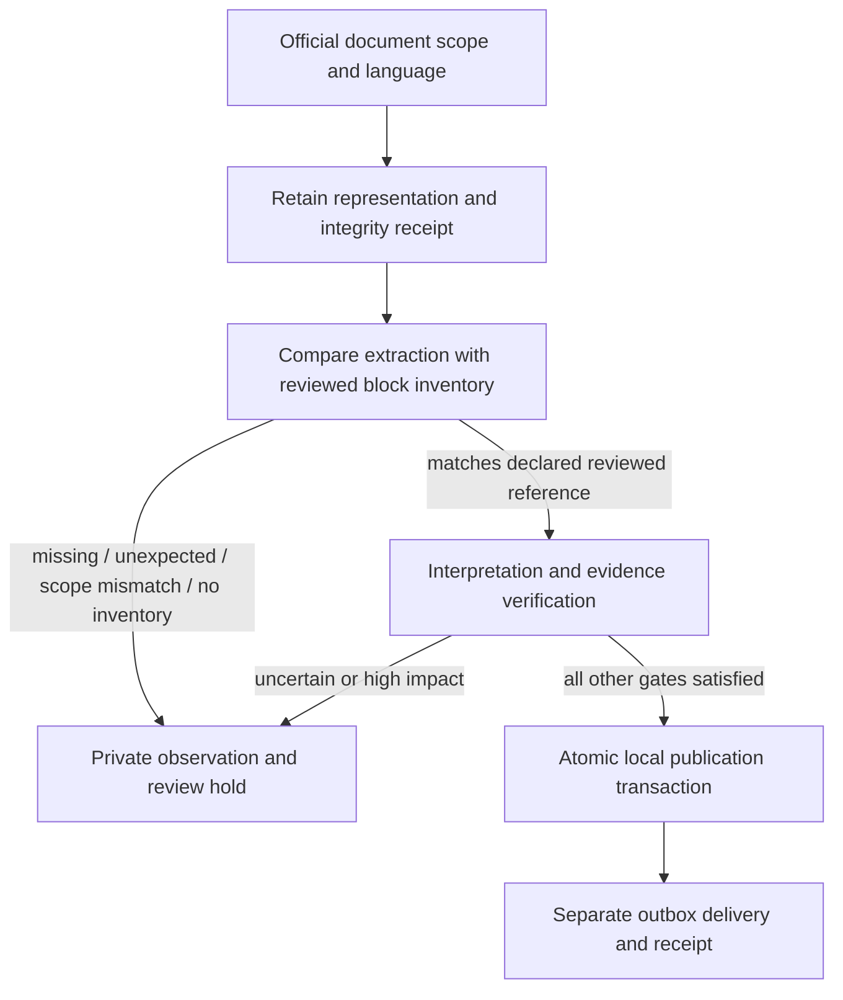

# Source completeness and responsible AI

22 November 2026. **Local implementation candidate, not a hosted qualification.** This methodology accompanies `codex/source-completeness-controls-20261122`. It does not change the identity or qualification evidence of hosted Preview r3, frozen candidate `050af19` or any earlier cohort.

## Four questions, four different controls

| Layer | Question | Bounded evidence | What it does not establish |
|---|---|---|---|
| Download integrity | Which representation was received and retained? | Requested/final source scope, response status, capture time, retained bytes/text and their digests. | An HTTP 200 or matching SHA256 does not show that the source supplied every clause, correct language or current origin content. |
| Extraction coverage | What document content survived processing? | Comparison of all structured blocks with a declared, separately reviewed reference, including repeated occurrences and section paths. | A reference can itself be incomplete. Agreement with it is not universal policy completeness. |
| Transaction atomicity | Was one local publication recorded consistently? | A database transaction can commit the baseline, change and outbox event together, or commit none of them. | Atomicity does not validate acquired text, its interpretation, external service state or actual notification delivery. |
| Interpretation | Do the passages support the proposed meaning? | Exact before/after citations, model/version evidence where recorded, separate verification and human review when needed. | A quotation match, model agreement or reviewer approval is not automatically legal correctness or source completeness. |



The diagram describes the candidate boundary. A successful transition at one layer does not bypass the next. Engine 6 public publication and notifications remain separately controlled; this document is not permission to enable them.

## Why the earlier contract was insufficient

The [22 November synthetic audit](../reports/policywatcher-demo-audit-2026-11-22/contract-falsifiers.json) used one complete control and six deliberately incomplete document objects. The earlier contract accepted four incomplete variants: a missing middle clause, one lost repeated occurrence, a missing table row and an emptied section whose heading remained. Missing required-heading and terminal variants were rejected.

This result isolates a contract blind spot. The objects bypass live retrieval and HTML extraction. **Four out of six is not a measured error rate for real policies, providers or the deployed system.** The complete control and the failed counterexamples remain evidence; later fixes must not erase the original result.

Title aliases, required headings, terminal text, length limits and language metadata remain useful identity and plausibility checks. They cannot alone establish that all intervening document content is present.

## Reviewed block inventory

The candidate adds `SourceContract.completenessInventory`. It is an explicit reviewed reference, not an automatically generated certificate. The implementation is in `src/lib/engine/coverage.ts` and its source-contract integration in `src/lib/engine/document.ts`.

### Scope and review evidence

The versioned inventory contains:

- `scope`: exact `sourceUrl`, expected `language` (`en` or `it`) and `referenceVersion`. Query and fragment distinctions remain part of the declared retrieval scope.
- `scopeId`: digest of the restricted sorted-key scope representation. It identifies that scope; it does not authenticate the source.
- `reference`: declared method (`manual_reference`, `publisher_reference` or `independent_capture`), reference URL, file digest, capture/review times and a meaningful review note.
- `units`: every distinct structured block group and its expected occurrence count.
- `inventorySha256`: digest of the inventory body excluding that digest field.

Parsing checks the declared fields and bounds, digests, review ordering and future timestamps. Contract parsing also binds inventory URL and language to the source contract. Invalid or mismatched metadata cannot be silently treated as a configured reference.

The reference method and review note are **attestations supplied by the reviewer**. They do not authenticate reviewer identity or independently prove that the reference was collected independently. `reference.sha256` is a declared file fingerprint: the engine does not retrieve and inspect that reference file simply because its hash is present. Retaining and examining the actual reference remains an operator/review responsibility.

### Every block and every repeated occurrence

The compared group identity is:

```text
(block kind, normalised section path, SHA256(normalised block text))
```

The inventory covers the structured representation's headings, paragraphs, lists and table blocks. Each group carries a positive occurrence count. A repeated clause therefore contributes more than once. A table row or a section's body cannot be omitted merely because the document title and ending still match.

Normalisation uses Unicode **NFC**, preserves case and compatibility characters, collapses whitespace runs and trims surrounding whitespace. It does not use compatibility folding or lowercasing to make changed contractual text appear equal. Digests refer to this declared normalised block representation, distinct from the digest of the entire exact retained extraction.

Matching is a multiset comparison. Missing expected occurrences and unexpected occurrences are both counted. Section paths distinguish equal text in different sections. A separate ordered-sequence digest also compares block order, including reordering within the same section. Its negative control preserves every occurrence while changing the sequence.

Budgets are bounded: at most 512 KiB for the serialised inventory and 10,000 total units/occurrences, with limits on paths, strings, structure and nesting. Unsupported keys, accessors and unsafe object shapes are not review evidence.

### Read the receipt with its denominator

`CoverageReceipt` separates:

| Field | Meaning |
|---|---|
| `state` | `not_configured`, `mismatch` or `matched_reviewed_reference`. |
| `expectedUnits`, `observedUnits` | Total expected occurrences versus observed structured blocks. |
| `expectedGroups`, `observedGroups` | Distinct kind/section/text groups, a different denominator from occurrence totals. |
| `missingUnits`, `unexpectedUnits` | Occurrence deficits and surpluses, not a percentage of legal correctness. |
| `scopeId`, `inventorySha256` | Exact declared reference context used for this assessment. |
| `reasons` | Explicit missing-reference, invalid-reference, scope/language mismatch or unit mismatch reasons. |

`matched_reviewed_reference` means agreement with that declared reviewed reference under this representation and normalisation. It must not be displayed as “the entire legal policy is complete.” A reference containing the same extraction defect could still agree with the candidate. Documents not loaded by the browser, external attachments, omitted clauses in the reference and an incorrectly defined scope remain possible blind spots.

## Publication and observation have different requirements

Legacy contracts without an inventory can still support bounded private acquisition and diagnostics. Their old heuristics may pass, but completeness remains unknown. The candidate publication check requires an eligible assessment **and** `matched_reviewed_reference`; missing, invalid, unexpected or mismatched inventory must hold publication.

This is a candidate gate, not a statement that hosted r3 has already gained it. Publication controls must cover baseline establishment, unchanged verification, changed candidates and resumed/cached paths consistently. The final implementation report must record which paths were actually tested and which remain open.

An authentic policy change can legitimately break the old inventory. That is a reason for a fresh source review, not a reason to rebuild the expected inventory from the new candidate and approve it automatically. Reference changes need a new version, retained supporting evidence, updated review context and a fresh assessment. The old reference and failed result remain available for comparison.

## Operator procedure

1. Define the document's exact official scope, language, expected attachments and retrieval representation before assessing completeness.
2. Retain an independent/manual/publisher reference and review the actual content against the official source. Confirm middle sections, repetitions, table rows, attachments and ending, not only the first and last passages.
3. Record reference method, version, digest, times and review note. Do not use a generated inventory as proof that this independent review occurred.
4. Compare the candidate's complete structured-block multiset. Inspect missing and unexpected occurrences, scope/language failures and any extraction warnings.
5. Keep uncertain cases private and held. If the policy genuinely changed, prepare and review a fresh reference; preserve the old result.
6. Assess interpretations separately against exact retained passages. Only the complete publication workflow may decide whether its remaining gates are satisfied.

The final verification receipt must identify implementation hash, fixture/reference versions, actual commands, positive and deliberately incomplete controls, and any retained failures. The delivery run passed 1,801 application tests offline, with 14 skipped. The detailed verification report separates the source-coverage, transport, workflow, administrative, locale and browser scopes. Offline counterexamples do not replace live source qualification or a realistic 500-policy/day worker campaign.

## Responsible AI in this workflow

The [NIST AI Risk Management Framework](https://www.nist.gov/itl/ai-risk-management-framework) is voluntary guidance for considering AI risks and trustworthiness across design, use and evaluation. Here it informs the separation of controls and explicit evidence limits; it does not certify PolicyWatcher.

The [OECD AI Principles](https://www.oecd.org/en/topics/ai-principles.html) call for understandable capability/limitation information, human oversight, traceability and accountability appropriate to context. In this workflow that means a reviewer can inspect source/reference versions, question an interpretation, withhold publication and retain corrections. This is a design mapping, not an assertion of full compliance or OECD endorsement.

Public transparency must preserve privacy: disclose the method, dates, denominators, failed tests and limits without exposing private captures, credentials, reviewer metadata or customer context. Model output remains an interpretation. Missing evidence remains unknown; it is not converted into zero risk, a cleared control or a legal violation. Human review needs the source evidence and power to stop or correct the workflow, not merely an approval button.

## Sintesi italiana

Integrità del download, copertura dell'estrazione, atomicità della transazione e interpretazione sono controlli diversi. L'hash consente di confrontare una rappresentazione conservata; non dimostra che la fonte abbia fornito tutte le clausole. Una transazione tutto-o-niente protegge la coerenza dei salvataggi, non il significato dei dati o la consegna delle notifiche.

Il candidato confronta tutti i blocchi strutturati con un inventario revisionato, legato a fonte e lingua. Tipo, percorso della sezione, hash del testo e occorrenze consentono di rilevare omissioni interne e ripetizioni perse. La corrispondenza vale soltanto rispetto al riferimento dichiarato: se il riferimento è incompleto, l'accordo non produce completezza indipendente. Una modifica autentica richiede un nuovo riferimento revisionato; un inventario assente può servire all'osservazione privata, non autorizzare la pubblicazione del candidato.

I quattro controesempi incompleti accettati su sei descrivono il limite del vecchio controllo in una prova sintetica mirata, non il tasso di errore delle fonti reali. Le verifiche del nuovo candidato, i modelli interrogati e la qualifica delle 500 policy al giorno devono essere riportati con prove e perimetri distinti. Nessuna certificazione o conformità legale è dedotta dai riferimenti NIST e OCSE.

The candidate also binds an ordered sequence fingerprint, so a reordering cannot pass merely by retaining the same multiset. Receipts explicitly keep `referenceOriginVerified=false` and `sourceCompletenessQualified=false`, including for matches. The reference file itself and its origin are not authenticated by the inventory metadata.
