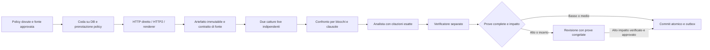

# PolicyWatcher Engine 6 - implementazione locale e verifica

31 ottobre 2026. Branch `codex/engine-v6-local`, base `680c0e549c369f8cc8db7ea8aaeca3b3ac56903e`. Il checkout è `/Users/fabriziodegni/Projects/PolicyWatcher-public-update-20261026`. Stato: preview locale `pw-engine-6.0.0-alpha.1`, disabilitata per default. Il prodotto pubblico mantiene la versione 5.2.0. Non è stata distribuita una release 6.0, né modificato il DB di produzione.

L'owner ha richiesto analisi, progetto e implementazione locale verificata, con affidabilità/copertura prioritarie, fino a 500 policy al giorno e pubblicazione automatica solo con prove complete; dubbi e impatto elevato richiedono revisione. Gli abbonamenti e l'infrastruttura non sono stati modificati.

## Diagnosi e cambiamenti

La [diagnosi iniziale](engine-audit-2026-10-31.md) riconcilia il batch di 50: 42 invariati, 4 candidati, 1 cambiamento pubblicato, 3 revisioni. Il testo del log riportava 49 policy. Le 48 acquisizioni uniche non erano il numero completo di richieste HTTP. Due policy erano recuperate ma prive di baseline di estrazione; X era bloccata e aveva solo una cattura storica. L'analisi AWS confondeva la data di aggiornamento con l'efficacia del contratto. Questi sono risultati circoscritti, non una misura dell'accuratezza complessiva.

Le correzioni immediatamente applicabili al percorso precedente comprendono riepilogo dei sospesi, timestamp e collegamento dei tentativi al run, separazione storico/live per il recupero degli incidenti, fedeltà delle celle brevi e ripetute, denominatore corretto della valutazione AI e completamento delle scritture prima della comunicazione dell'esito. Il profilo dell'estrattore ora dipende dalle trasformazioni e dalle dipendenze rilevanti; una modifica alla UI non deve invalidare tutte le baseline.

Il nuovo percorso è una pipeline persistente:

### Implementato

- Coda durevole per acquisizione, valutazione, analisi, verifica e commit, con checkpoint, ledger dei tentativi, lease rinnovabili, fencing e ripresa. Un vincolo univoco impedisce due task attivi per la stessa policy. I run HTTP accodano il lavoro e terminano con 202.
- Pianificazione di massimo 500 policy dovute, priorità alle conferme, dedup delle rappresentazioni realmente compatibili, esclusione delle policy già prenotate e backoff persistente per origine. Un'origine limitata non blocca le altre.
- Riutilizzo dei trasporti protetti esistenti: destinazioni pubbliche, controlli DNS/redirect e limiti del corpo. I redirect non ricevono validatori di un'altra rappresentazione. La preview non usa un archivio per attestare la disponibilità live.
- Contratti di fonte revisionati: URL, titolo, sezioni obbligatorie, testo terminale, lingua e limiti dimensionali. La presenza di parole come “privacy” non basta. Un contratto mancante non provoca tre tentativi di trasporto né degrada l'intero catalogo pubblico.
- Artefatti indirizzati per hash, verifica di integrità in lettura, parser con heading/paragrafi/liste/tabelle, offset UTF-16 e conservazione delle ripetizioni. I documenti sono limitati a 500.000 caratteri.
- Cache condizionale legata a profilo, integrità e hash della baseline. I validatori entrano nella cache soltanto dopo un commit verificato. `304` significa riconvalida della rappresentazione disponibile, mai seconda cattura indipendente di un cambiamento.
- Due catture live in run distinti, distanti almeno un'ora e al massimo sette giorni. I retry AI riusano le prove congelate e non ripetono l'acquisizione. Interruzioni transitorie non cancellano automaticamente un candidato.
- Confronto per blocchi; citazioni esatte di tutti i delta; ruoli old/new, negazioni e contesto di tabella; distinzione “last updated”/“effective”. Il verificatore controlla separatamente ogni affermazione e le due lingue. Qualunque delta scoperto o verdetto incerto sospende l'intero cambiamento.
- Richiesta al modello con una sola copia del contesto documentale, conteggio preventivo dei token, limiti di input/output, ricevute con modello, versione del prompt, hash e token. I limiti permanenti non vengono ritentati come guasti temporanei.
- Pubblicazione atomica di baseline, snapshot, cambiamento, grafo canonico e evento outbox. L'approvazione umana ricontrolla prove, contesto e baseline; non può sanare una citazione inventata o una baseline mancante. Una revisione scaduta può richiedere nuove prove, conservando i checkpoint precedenti.
- Un nuovo estrattore può riprodurre il vecchio HTML conservato, ma la sostituzione della baseline richiede approvazione esplicita. Non si applica mai il parser precedente a una nuova cattura per dedurre che non esistano cambiamenti. Le migrazioni di fonte richiedono riconferma anche a testo identico.
- Outbox separata dal commit, fanout univoco per destinatario, ricontrollo di consenso e preferenze, `Message-ID` stabile e numero limitato di tentativi. Il protocollo SMTP resta **at-least-once**: un invio riuscito seguito da crash prima dell'ack può duplicarsi. I run manuali della preview sono esplicitamente silenziosi; il cron conserva la modalità iscritti, soggetta al flag di consegna.
- Workspace `/admin/engine`: copertura configurata, baseline verificate, candidati, run persistenti, motivi dei blocchi, confronto prima/dopo, citazioni, verdetti, approvazione, chiusura e richiesta di nuove prove. Link al percorso esistente di riparazione delle baseline.
- Migrazione additiva SQLite e PostgreSQL, inizializzatori Node/Python allineati, inventario di readiness e backup cifrato esteso. I backup precedenti continuano ad avere un inventario riconoscibile.

## Revisioni indipendenti effettive

Gemini 4 Argon con ragionamento **Alta**, via web in Vivaldi, e **GLM-5.3 Max**, in modalità Plan nell'app ZCode, hanno revisionato progetto e candidato di codice congelato. Non sono sostituzioni con subagenti OpenAI. Le richieste vietavano modifiche, scansioni, invii e lettura di segreti. I revisori hanno ricevuto codice selezionato e fixture, senza credenziali o dati degli iscritti.

Le trascrizioni sono conservate localmente in `output/engine-implementation-2026-10-31/`. Il candidato 1 comprende 10 file e ha manifest SHA256 `c27e32e70a511e813e579f882f5e3bb658c4b4daf531d9c74617a354089c348b`. Il candidato 2 comprende 12 file, con manifest `8059b170cfaddb7f5dd1e20eba4e6ba8ffcce90229a70de0bb50400418a0cb20`; include le correzioni e un diff immutabile. Il manifest finale distingue eventuali correzioni successive: una revisione di un candidato non è presentata come certificazione di ogni riga successiva.

| Rilievo | Decisione e verifica |
| --- | --- |
| Gemini: retry di acquisizione mancanti | Corretto; retry bounded, Retry-After e candidato conservato, regressione dedicata. |
| Gemini: cache di contenuto non confermato | Corretto; scrittura al commit e confronto col baselineHash. |
| Gemini: review deduplicata con timestamp vecchio | Corretto; nuova revisione per la nuova cattura; storico e note immutabili, stato e pianificazione separati per observe/publish. |
| Gemini: heading, asterischi e CRLF fusi | Corretto con parsing per righe che conserva offset e terminatori originali. |
| Gemini: citazioni brevi e header/righe separati rifiutati | Corretto; brevi blocchi completi e header ancorato separatamente, senza allentare la copertura della riga. |
| Gemini: contesto duplicato oltre budget | Corretto; rappresentazione compatta completa e preflight token. |
| Gemini: origini limitate e duplicazione policy | Corretto; filtro delle origini, priorità dei candidati e prenotazione univoca. |
| Gemini: destinatari non confermati e ultimo lease outbox | Corretto; consenso esplicito, scadenza terminale e controllo dell'ack DB. |
| GLM: task superato degrada stato pubblico | Corretto; CAS anche nei hold, errore di contesto terminale senza degradazione; regressione di modifica concorrente. |
| GLM: nessun contratto degrada tutto il catalogo | Corretto; nessuna richiesta di rete, nessuna modifica allo stato pubblico, revisione di configurazione deduplicata. |
| GLM: conferma pendente marcata come guasto | Corretto; osservazione idonea con stato disponibile e motivo di attesa distinto. |
| GLM: replay automatico pubblica baseline diversa | Corretto; revisione esplicita prima della sostituzione; nessun evento di modifica del provider. |
| GLM: revisioni senza uscita | Corretto; close/reject, refresh, nuove revisioni immutabili con prove nuove e supersession dopo pubblicazione. |
| GLM: notificare anche run silenziosi | Non accolto: violerebbe la modalità intenzionale e visibile. Accolto il controllo del risultato dell'ack outbox. |
| GLM: controllo finale della lease | Mantenuta la scadenza posseduta all'inizio della transazione, perché `finishTask` azzera il campo; transazione solo DB, timeout 15s. Accolto il reset dello stato heartbeat dopo rinnovo riuscito. Contesa su più processi resta da qualificare. |
| GLM: obiezione a D3 dell'audit iniziale | Ritirata dal revisore: aveva letto il working tree già corretto. Il codice base mostrava recupero su `status=ok` senza gate live/comparabile. |
| Gemini: equivalenza ottenuta col vecchio parser sul nuovo HTML | Non adottata: il parser lossy potrebbe nascondere una modifica reale. Serve il vecchio input conservato, altrimenti revisione. |

### Verifica delle correzioni e rilievi residui

GLM ha chiuso i rilievi iniziali sul candidato 2 e ha individuato la prenotazione bloccata spegnendo publication a run aperto: aggiunta cancellazione amministrativa durevole, con test di fencing del vecchio worker e riaccodamento observe. Confermati localmente gli hook del profilo e il default notifiche del cron; aggiunto test di approvazione della sola formattazione. L'esaurimento dei tentativi resta visibile come Needs Review con motivo tecnico, senza cancellare baseline o candidato: la disponibilità del vecchio testo non equivale a controllo corrente riuscito.

Gemini ha chiuso i problemi iniziali e segnalato cinque residui: (1) stato observe/publish condiviso; (2) metadati e disponibilità dopo approvazione baseline; (3) review obsolete dopo contratto o verifica invariata; (4) migrazione di fonte con hash identico; (5) sovrascrittura della review o duplicati attivi da HTML dinamico. Tutti affrontati localmente dopo il candidato 2: chiave di stato `(policyId, mode)`, osservazioni non approvabili come pubblicazione, cache non scritta dall'observer, ripristino della disponibilità con data della cattura, nessuno snapshot ridondante per replay identico, lingua del replay esplicitamente revisionata, chiusura delle review obsolete, riconferma delle migrazioni e una sola review corrente con storico immutabile. Sono state aggiunte regressioni mirate. Le ultime correzioni non sono presentate come un terzo audit dei modelli: il loro ambito esatto è nel manifest finale.

Le revisioni dei modelli aiutano a individuare difetti, ma non misurano l'efficacia del recupero in produzione, non sono test eseguiti dai revisori e non sostituiscono la qualificazione operativa.

## Verifica locale

Le verifiche automatiche usano database temporanei e servizi sintetici. Coprono due client SQLite, scadenza e riacquisizione delle lease, rollback a scadenza durante transazione, due catture indipendenti, una sola pubblicazione, checkpoint AI, 304, isolamento observe, alto impatto, baseline mancanti, corruzione, piano da 500 record, consenso, retry, identità/completezza, lingua italiana, tabelle e date. Il piano da 500 dimostra scheduling e dedup, non 500 recuperi Internet riusciti.

La prova dell'interfaccia usa un database dedicato `engine-preview-v2.db`, una policy sintetica chiaramente etichettata, credenziali di test, API AI assenti e notifiche disabilitate. Il server è vincolato al loopback; il suo piccolo adattatore sovrascrive il campo di identità del client con l'indirizzo del socket, senza disabilitare il gate di login. Log, screenshot e conteggi prima/dopo sono nella cartella di evidenza locale.

Il [registro finale della verifica](engine-v6-verification-2026-10-31.md) riporta 1.369 test superati e 14 esclusi, inclusi 43 test del nuovo motore, build, TypeScript e lint. La prova UI ha prodotto un solo cambiamento sintetico dopo approvazione, zero notifiche e cancellazione verificata del run observe. Il [manifest dei file](engine-v6-source-manifest-2026-10-31.json) distingue il codice successivo al candidato revisionato. I limiti sono separati dalle prove superate.

## Attivazione e limiti della preview

I tre flag `POLICYWATCHER_ENGINE_V6`, `POLICYWATCHER_ENGINE_PUBLICATION` e `POLICYWATCHER_ENGINE_NOTIFICATIONS` sono tutti `0` nell'esempio di configurazione. Il worker richiede esplicitamente V6 e DATABASE_URL. Il nuovo percorso disabilita la scansione inline legacy, evitando due scrittori concorrenti. Disabilitare la pubblicazione lascia i run publish accodati; l'azione admin Cancel remaining work li cancella conservando prove e checkpoint, recinta i worker precedenti e libera le prenotazioni per nuovi run observe. `POLICYWATCHER_SCANS_PAUSED=1` impedisce nuovi claim e consegne. Arrestare e supervisionare il processo durante cambi di configurazione.

Per staging: copia consistente e ripristino verificato del DB; migrazione additiva; contratti di fonte e baseline verificati; V6=1 con publication=0 e notifications=0; worker supervisionato **accanto al DB**; scheduler che invoca il POST cron almeno ogni ora per raccogliere le conferme, mentre ogni baseline stabile è dovuta dopo 24 ore. La pianificazione è durevole, ma la preview non installa un servizio systemd/cron sul server remoto.

Prima della pubblicazione live servono almeno tre finestre complete sul catalogo reale e un corpus annotato: precisione di identità/completezza, falsi cambiamenti, copertura dei delta, affermazioni non supportate, tempi, costo/token, tasso di review, spazio e restore. L'owner richiede priorità alla qualità: nessuna promozione automatica sulla base del solo numero di test verdi.

Restano fuori da questa implementazione: OCR di PDF scansiti, ricostruzione generalizzata di strutture PDF, onboarding automatico non supervisionato di 500 contratti, protocollo di worker remoto, promozione automatica di modelli/strategie, garbage collection delle prove e integrazione di object storage. L'estrazione PDF esistente continua nel trasporto, ma lingua e struttura devono superare gli stessi gate: i casi ambigui restano in revisione. Le dashboard di affidabilità storiche descrivono il percorso legacy; per i run V6 il registro e la copertura autorevoli sono nel workspace Engine 6. Non è stata eseguita una rehearsal con un server PostgreSQL reale né un audit dinamico indipendente del nuovo motore.

SQLite deve restare su disco locale condiviso solo da processi dello stesso host. Per grandi archivi, il backup consistente del DB e delle prove va dimensionato separatamente: l'esportazione JSON cifrata in memoria non è una soluzione dimostrata per decine di GB. Nessuna cancellazione automatica di prove è abilitata.

Il [budget](engine-v6-budget-2026-10-31.md) propone una riserva di 120–200 €/mese per il motore con ipotesi esplicite. Il piano corrente è stato verificato nel pannello: KVM 1, 1 vCPU/4 GB/50 GB, circa 37 GB occupati, rinnovo mensile 19,49 USD più imposte. Il budget distingue il piano già pagato dalle offerte annuali KVM 2/KVM 4 e dalla riserva API. Nessun acquisto o rinnovo eseguito.
