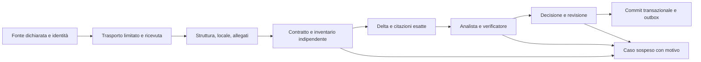

# PolicyWatcher  -  audit per la dimostrazione del 22 novembre 2026

**Esito: dimostrazione consentita entro i limiti delle prove raccolte. Non qualificati completezza delle fonti, accuratezza semantica dell’intera pipeline e500 policy completate al giorno.** Questo è un assessment mirato di codice, controlli, dati operativi e interfacce: non un pentest né una certificazione del prodotto.

## Identità e stato di consegna

| Componente | Stato verificato |
|---|---|
| Sito pubblico | Prodotto stabile5.5.0, scanner consolidato; 35 tabelle applicative,19 migrazioni |
| Engine6 hosted | Preview privata r3 originale, implementazione `84085328fffc7b22fac33cc2cbe150120c540b75deda59d3b207c32b768a9a00`; pubblicazione/notifiche0 |
| Codice candidato | Revisione algoritmi `c7deedb`; successiva integrazione UI/iOS non viene attribuita a r3 |
| Vecchia coorte temporale | Candidato congelato separato; le sue osservazioni non qualificano il codice corrente |
| Companion Chromium | Versione indipendente3.8.3 Beta3, manifest3.8.3.3; nessun nuovo runtime Chromium imposto dal numero Engine6 |
| Safari iOS | Candidato per sviluppatori0.1.0(1), non firmato, non disponibile su App Store/TestFlight |

Il diario21novembre è stato pubblicato durante questa sessione. La prima verifica visiva ha poi evidenziato una dateline ancora16novembre: errore conservato e corretto nel codice. La correzione dateline ha superato staging e r3 è stata ripristinata. La riconciliazione più ampia di Atlas/roadmap/ENIT e il nuovo audit sono **preparati, non ancora dichiarati pubblicati**. La ricevuta conclusiva di consegna registrerà gli effettivi deployment e la verifica dopo pubblicazione, senza confondere ZIP o staging con produzione.

## Cosa abbiamo verificato

- **215 test offline in8 suite** sui controlli di acquisizione, task/worker, confini privati, pubblicazione e verifica produzione. Rete negata dal sistema operativo.
- **75 test frontend** ripetuti da un revisore indipendente; **83 test** dopo integrazione nel menu più ricco di main. Sono suite sovrapposte: non sommarle come prove indipendenti.
- Rendering EN/IT e cambio lingua verificati su mobile/desktop; controlli negativi ripristinando link italiano e intestazioni errate falliscono. Atlas, feature atlas, roadmap e form conservano lingua, canonical e valori del modulo. Gli inventari tecnici storici rimasti in inglese sono dichiarati tali.
- Produzione letta senza modifiche: API con113 configurate,113 con recuperi storici,113 con evidenza di baseline,112 pubbliche,59 analizzate. Non sono misure di completezza corrente. Conteggi grezzi DB e filtri pubblici sono distinti nella [relazione tecnica](policywatcher-demo-audit-2026-11-22/assessment.md).
- Hosting CloudLinuxLVE e renderer rispondente rilevati: capacità dichiarata3, zero lavori attivi alla lettura. Nessun render job eseguito e nessuna capacità500/day dedotta dai48CPU/~376GiB visibili del nodo condiviso.
- Dopo manutenzione, r3 originale confermata con3 rapporti salvati,24 task completati e zero task attivi; evidenze preservate. I48 confronti comprendono47 tabelle applicative più ledger migrazioni; gli hash delle14 tabelle di evidenza restano separati dallo stato operativo `EngineOrigin`.
- GLM, Gemini/Orchestrator, Opus e LMStudio utilizzati **nelle app native**. Revisioni consultive e loro errori sono [documentati e giudicati](policywatcher-demo-audit-2026-11-22/model-review-adjudication.md), senza attribuire loro test non eseguiti.

## La scoperta principale: il contratto non prova completezza

Il nuovo falsificatore offline usa un controllo completo e sei documenti sintetici incompleti. **Quattro dei sei incompleti passano ancora `contract_satisfied`: clausola centrale mancante, occorrenza ripetuta persa, riga di tabella mancante e sezione obbligatoria vuota.** Heading obbligatorio e terminale mancanti vengono invece sospesi correttamente. È una prova dell’osservabilità del contratto, non un benchmark del parser HTML.

Questo impedisce di usare “contratto soddisfatto” come sinonimo di “fonte completa”. Il rimedio richiede un inventario indipendente di unità critiche, occorrenze, tabelle e allegati, con controlli positivi e negativi; una soglia generica di parole o un hash non risolvono il problema. [Sette casi e risultati](policywatcher-demo-audit-2026-11-22/contract-falsifiers.json).

## Acquisizione, QA e pubblicazione

Il codice offre controlli URL/DNS, redirect, backoff, ricevute, confronti strutturali, citazioni e verificatore separato, lease/CAS e outbox. **r3 non ha renderer remoto, chiave Gemini o coppia analista/verificatore configurati**: una sola fonte ha un contratto, nessuna baseline/claim/outbox. Non si può quindi mostrare un flusso semantico completo operativo in questo ambiente. Le app dei revisori non forniscono credenziali o quota alla pipeline.

La prova storica500-scope viaSSH ha ottenuto367 estrazioni e133 casi falliti/sospesi in772,602secondi. Il successivo follow-up133 ha recuperato4 estrazioni e lasciato129 sospesi:98 trasporto,24 dimensione,4 backoff,3 blocco/soft404. I31 HTTP200 includono27 sospesi in estrazione. Non sommare367+4 per dichiarare una singola prova371/500 o capacità giornaliera.

## Estensioni e iOS

Corretto il packaging che rifiutava il dominio canonico e rafforzati i controlli di origine contro credenziali nell’URL e suffissi ingannevoli. Sei regressioni nuove e13 test esistenti passano offline, con controllo negativo sul codice precedente. Il codice Chromium non è stato alterato per cambiare il numero di versione del prodotto.

Il candidato Safari iOS0.1.0(1) compila per simulatore e dispositivo senza firma;11 file runtime coincidono con3.8.3.3. Quattro XCTest sul vero handler e sei testVM sul worker impacchettato passano. Il contenitore è stato installato e ha mostrato l’onboarding inglese su un simulatore dedicato iPhone/iOS27.1; fotogramma bianco iniziale e timeoutOCR sono conservati. **Questo non dimostra il funzionamento dell’estensione in Safari.** Restano Safari reale, iPad, dispositivo fisico, iOS17 minimo, accessibilità, firma, titolarità, privacy finale e revisione Apple. Kit publisher EN/IT pronto. [Assessment e asset](browser-extension-ios-assessment-2026-11-22.md).

## Priorità prima della qualifica

1. **Completezza:** inventario annotato indipendente per clausole/occorrenze/tabelle/allegati e falsificatori su catture reali; conservare il riferimento rosso attuale.
2. **Accuratezza semantica:** configurare un candidato isolato, verificare quota gratuita reale e coppia di modelli, giudicare citazioni e implicazioni contro un riferimento umano cieco. Nessuna attivazione pubblica di r3.
3. **Capacità:** misurare500 fonti distinte sul worker previsto, tempi per stadio, code, blocchi, memoria allocata, recupero e arresto naturale; non sostituire con un testSSH o readiness renderer.
4. **Scalabilità amministrativa:** paginare i task e separare aggregati dal polling completo ogni5secondi; rischioP2, non incidente dimostrato sui24 task attuali.
5. **Conservazione:** definire retention/GC degli artefatti con protezione delle evidenze referenziate e prova di recupero. Nessuna cancellazione nell’audit.
6. **Apple:** chiudere la matrice Safari/device e i dati del publisher; firmare e sottoporre solo dopo queste verifiche. Il pacchetto unsigned non va presentato come app installabile per il pubblico.

## Sequenza consigliata per il video

Aprire il sito stabile e mostrare il funnel con definizioni e data dell’ultima cattura; passare alla Preview privata e a un rapporto già salvato, senza avviare scansioni o approvazioni; mostrare differenze, evidenze e casi sospesi; tornare ad Atlas, roadmap, changelog e diario bilingue; presentare iOS come candidato in collaudo. Dichiarare chiaramente ciò che è osservato, implementato e ancora da qualificare.

**Formula breve:** “PolicyWatcher5.5 è il servizio stabile. Engine6 è il laboratorio privato: conserva le prove, confronta le estrazioni e mantiene in revisione i casi incerti. Rendiamo pubblici anche i test che falliscono. Completezza, verifica semantica e500 policy completate al giorno sono i prossimi gate, non risultati già raggiunti.”

## Evidenze e limiti

[Back office e hosting](policywatcher-demo-audit-2026-11-22/assessment.md) · [Revisione frontend](policywatcher-demo-audit-2026-11-22/frontend-independent-review.md) · [Test integrazione main](policywatcher-demo-audit-2026-11-22/main-frontend-integration-tests.log) · [Revisori nelle app](policywatcher-demo-audit-2026-11-22/model-review-adjudication.md) · [Prima consegna del diario](engine-v6-remote133-2026-11-21/delivery-initial/receipt.json).

Nessuna nuova scansione pubblica, notifica, approvazione baseline, acquisto o attivazione Engine6 è stata eseguita per questa dimostrazione. La navigazione amministrativa e la consegna finale del nuovo pacchetto richiedono ancora la finestra Vivaldi coordinata: saranno registrate con ricevute effettive, non inferite dai testAPI. Nessun nuovoP0/P1 dimostrato nell’ambito esaminato; non equivale a un audit di sicurezza esaustivo.
