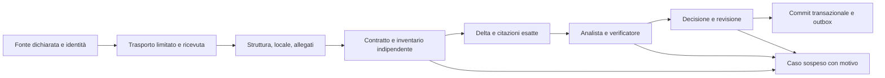

# PolicyWatcher - audit per la dimostrazione del 22 novembre 2026

**Aggiornamento di consegna:** codice e audit sono integrati in main tramite la PR #77, con sei controlli CI superati; il kit iOS non firmato è ora pubblicato e verificato su GitHub. Il nuovo pacchetto del sito è pronto ma non ancora distribuito; renderer remoto e Apple restano consegne separate. [Ricevuta e stato effettivo](policywatcher-demo-audit-delivery-2026-11-22.md).

**Esito: dimostrazione dei controlli e dei rapporti esistenti consentita entro i limiti delle prove raccolte. Due P1 del renderer sono stati riprodotti localmente; il servizio remoto resta 1.2.0 e richiede una correzione verificata prima di una prova di carico. Non qualificati completezza delle fonti, accuratezza semantica dell’intera pipeline e 500 policy completate al giorno.** Questo è un assessment mirato di codice, controlli, dati operativi e interfacce: non un pentest né una certificazione del prodotto.

## Identità e stato di consegna

| Componente | Stato verificato |
|---|---|
| Sito pubblico | Prodotto stabile 5.5.0, scanner consolidato; 35 tabelle applicative, 19 migrazioni |
| Engine 6 hosted | Preview privata r3 originale, implementazione `84085328fffc7b22fac33cc2cbe150120c540b75deda59d3b207c32b768a9a00`; pubblicazione/notifiche disabilitate |
| Codice candidato | Revisione algoritmi `c7deedb`; successiva integrazione UI/iOS non viene attribuita a r3 |
| Vecchia coorte temporale | Candidato congelato separato; le sue osservazioni non qualificano il codice corrente |
| Companion Chromium | Versione indipendente 3.8.3 Beta 3, manifest 3.8.3.3; nessun nuovo runtime Chromium imposto dal numero Engine 6 |
| Safari iOS | Candidato per sviluppatori 0.1.0 (1), non firmato, non disponibile su App Store/TestFlight |

Il diario del 21 novembre è stato pubblicato durante questa sessione. La prima verifica visiva ha poi evidenziato una dateline ancora al 16 novembre: errore conservato e corretto nel codice. La correzione dateline ha superato staging e r3 è stata ripristinata. La riconciliazione più ampia di Atlas/roadmap/EN/IT è preparata per il dominio, non ancora distribuita. Codice e audit sono pubblici su GitHub; ciò non aggiorna automaticamente il sito. La ricevuta conclusiva di consegna registrerà gli effettivi deployment e la verifica dopo pubblicazione, senza confondere ZIP o staging con produzione.

## Cosa abbiamo verificato

- **215 test offline in 8 suite** sui controlli di acquisizione, task/worker, confini privati, pubblicazione e verifica produzione. Rete negata dal sistema operativo.
- **75 test frontend** ripetuti da un revisore indipendente; **83 test** dopo integrazione nel menu più ricco di main. Sono suite sovrapposte: non sommarle come prove indipendenti.
- Rendering EN/IT e cambio lingua verificati su mobile/desktop; controlli negativi ripristinando link italiano e intestazioni errate falliscono. Atlas, feature atlas, roadmap e form conservano lingua, canonical e valori del modulo. Gli inventari tecnici storici rimasti in inglese sono dichiarati tali.
- Produzione letta senza modifiche: API con 113 configurate, 113 con recuperi storici, 113 con evidenza di baseline, 112 pubbliche, 59 analizzate. Non sono misure di completezza corrente. Conteggi grezzi DB e filtri pubblici sono distinti nella [relazione tecnica](policywatcher-demo-audit-2026-11-22/assessment.md).
- Hosting CloudLinux LVE e renderer rispondente rilevati: capacità dichiarata 3, zero lavori attivi alla lettura. Nessun render job eseguito e nessuna capacità 500/giorno dedotta dai 48 CPU/~376 GiB visibili del nodo condiviso.
- Dopo manutenzione, r3 originale confermata con 3 rapporti salvati, 24 task completati e zero task attivi; evidenze preservate. I 48 confronti comprendono 47 tabelle applicative più ledger migrazioni; gli hash delle 14 tabelle di evidenza restano separati dallo stato operativo `EngineOrigin`.
- GLM, Gemini/Orchestrator, Opus e LM Studio utilizzati **nelle app native**. Revisioni consultive e loro errori sono [documentati e giudicati](policywatcher-demo-audit-2026-11-22/model-review-adjudication.md), senza attribuire loro test non eseguiti.

## Il limite riconfermato: il contratto non prova completezza

La riesecuzione sul candidato corrente del falsificatore già documentato usa un controllo completo e sei documenti sintetici incompleti. **Quattro dei sei incompleti passano ancora `contract_satisfied`: clausola centrale mancante, occorrenza ripetuta persa, riga di tabella mancante e sezione obbligatoria vuota.** Heading obbligatorio e terminale mancanti vengono invece sospesi correttamente. È una prova dell’osservabilità del contratto, non un benchmark del parser HTML.

Questo impedisce di usare “contratto soddisfatto” come sinonimo di “fonte completa”. Il rimedio richiede un inventario indipendente di unità critiche, occorrenze, tabelle e allegati, con controlli positivi e negativi; una soglia generica di parole o un hash non risolvono il problema. [Sette casi e risultati](policywatcher-demo-audit-2026-11-22/contract-falsifiers.json).

## Acquisizione, QA e pubblicazione

Il codice offre controlli URL/DNS, redirect, backoff, ricevute, confronti strutturali, citazioni e verificatore separato, lease/CAS e outbox. **r3 non ha renderer remoto, chiave Gemini o coppia analista/verificatore configurati**: una sola fonte ha un contratto, nessuna baseline/claim/outbox. Non si può quindi mostrare un flusso semantico completo operativo in questo ambiente. Le app dei revisori non forniscono credenziali o quota alla pipeline.

La prova storica via SSH su 500 perimetri e 495 endpoint ha ottenuto 367 estrazioni e 133 casi falliti/sospesi in 772,602 secondi. Il successivo follow-up sui 133 casi ha recuperato 4 estrazioni e lasciato 129 sospesi: 98 trasporto, 24 dimensione, 4 backoff, 3 blocco/soft404. I 31 HTTP 200 includono 27 sospesi in estrazione. Non sommare 367+4 per dichiarare una singola prova 371/500 o capacità giornaliera.

## Estensioni e iOS

Corretto il packaging che rifiutava il dominio canonico e rafforzati i controlli di origine contro credenziali nell’URL e suffissi ingannevoli. Sei regressioni nuove e 13 test esistenti passano offline, con controllo negativo sul codice precedente. Il codice Chromium non è stato alterato per cambiare il numero di versione del prodotto.

Il candidato Safari iOS 0.1.0 (1) compila per simulatore e dispositivo senza firma; 11 file runtime coincidono con 3.8.3.3. Quattro XCTest sul vero handler e sei test VM sul worker impacchettato passano. Il contenitore è stato installato e ha mostrato l’onboarding inglese su un simulatore dedicato iPhone/iOS 27.1; fotogramma bianco iniziale e timeout OCR sono conservati. **Questo non dimostra il funzionamento dell’estensione in Safari.** Restano Safari reale, iPad, dispositivo fisico, iOS 17 minimo, accessibilità, firma, titolarità, privacy finale e revisione Apple. Kit publisher EN/IT pronto. [Assessment e asset](browser-extension-ios-assessment-2026-11-22.md).

## Priorità prima della qualifica

1. **Completezza:** inventario annotato indipendente per clausole/occorrenze/tabelle/allegati e falsificatori su catture reali; conservare il riferimento rosso attuale.
2. **Accuratezza semantica:** configurare un candidato isolato, verificare quota gratuita reale e coppia di modelli, giudicare citazioni e implicazioni contro un riferimento umano cieco. Nessuna attivazione pubblica di r3.
3. **Capacità:** misurare 500 policy con perimetri espliciti e conteggio separato degli endpoint sul worker previsto, tempi per stadio, code, blocchi, memoria allocata, recupero e arresto naturale; non sostituire con un test SSH o readiness renderer.
4. **Scalabilità amministrativa:** paginare i task e separare aggregati dal polling completo ogni 5 secondi; rischio P2, non incidente dimostrato sui 24 task attuali.
5. **Conservazione:** definire retention/GC degli artefatti con protezione delle evidenze referenziate e prova di recupero. Nessuna cancellazione nell’audit.
6. **Apple:** chiudere la matrice Safari/device e i dati del publisher; firmare e sottoporre solo dopo queste verifiche. Il pacchetto unsigned non va presentato come app installabile per il pubblico.

## Sequenza consigliata per il video

Aprire il sito stabile e mostrare il funnel con definizioni e data dell’ultima cattura; passare alla Preview privata e a un rapporto già salvato, senza avviare scansioni o approvazioni; mostrare differenze, evidenze e casi sospesi; tornare ad Atlas, roadmap, changelog e diario bilingue; presentare iOS come candidato in collaudo. Dichiarare chiaramente ciò che è osservato, implementato e ancora da qualificare.

**Formula breve:** “PolicyWatcher 5.5 è il servizio stabile. Engine 6 è il laboratorio privato: conserva le prove, confronta le estrazioni e mantiene in revisione i casi incerti. Rendiamo pubblici anche i test che falliscono. Completezza, verifica semantica e 500 policy completate al giorno sono i prossimi gate, non risultati già raggiunti.”

## Evidenze e limiti

[Back office e hosting](policywatcher-demo-audit-2026-11-22/assessment.md) · [Revisione frontend](policywatcher-demo-audit-2026-11-22/frontend-independent-review.md) · [Test integrazione main](policywatcher-demo-audit-2026-11-22/main-frontend-integration-tests.log) · [Revisori nelle app](policywatcher-demo-audit-2026-11-22/model-review-adjudication.md) · [Prima consegna del diario](engine-v6-remote 133-2026-11-21/delivery-initial/receipt.json).

Nessuna nuova scansione pubblica, notifica, approvazione baseline, acquisto o attivazione Engine 6 è stata eseguita per questa dimostrazione. La navigazione amministrativa è stata avviata in un browser di collaudo isolato: dashboard, Dataset QA, VPS Services e Production Verification sono stati realmente renderizzati. Dataset QA resta FAIL (90,5; un critical, 161 warning, 14 issue aperte; copertura KPI storica 79,8%; sette verifiche oltre 30 ore), mentre i nove controlli interni operativi passano e il controllo di sicurezza indipendente resta external. Una race del login prima della piena idratazione è stata riprodotta e corretta localmente, con controlli negativi sul parent. La Preview è stata poi realmente aperta in quel browser: tre run salvati, un run espanso con otto righe task e una osservazione congelata aperta. L’osservazione selezionata è esplicitamente sospesa per contratto mancante e non contiene una risposta HTTP: non presentarla come cattura completa o verifica semantica. Un precedente runner classificava erroneamente il redirect privato verso `/admin/engine` come login fallito; ricevuta e correzione del classificatore sono conservate. La correzione del login è verificata localmente sul parent e sul fix, non ancora pubblicata. La consegna finale del pacchetto pubblico attende la finestra Vivaldi coordinata. L’estensione dell’assessment al renderer ha riprodotto due P1 locali: superamento del limite di concorrenza e mancato recupero dopo un primo avvio browser fallito. Il servizio remoto 1.2.0 non è stato sottoposto a questi esperimenti e nessun incidente remoto è dimostrato. Il candidato renderer 1.2.1 corregge entrambi i P1 e supera 28 test Node, più tre probe indipendenti. Il servizio remoto non è stato aggiornato e la validazione con Chromium reale resta un gate di promozione. Questo assessment non equivale a un audit di sicurezza esaustivo.

### Identità e primi errori CI conservati

La prima CI della PR #77 su `1f9665f` ha respinto la build e due suite di coverage perché il manifest implementazione non rifletteva `src/lib/seo.ts`, incluso nella chiusura delle dipendenze. Il controllo ha correttamente impedito l’esecuzione dei canali sperimentali. Rigenerato il manifest da `31d3d5…` a `11083baefcc414bd7db1eb0a46f922a5a742adefce01e3e037e812c66d56540a`; l’unico hash di dipendenza cambiato è SEO. Dopo la rigenerazione, 14 test scanChannels passano offline. Nessun test è stato indebolito. L’identità del nuovo candidato cambia anche per questa dipendenza: nessuna osservazione della coorte precedente viene trasferita al nuovo hash; r3 hosted resta originale. Gli esiti dei successivi controlli CI saranno registrati separatamente.

### Suite integrata e UI osservata

Dopo la riconciliazione dei consumer EN/IT, **1.692 test passano e 14 sono saltati in 213 file (210 passati, 3 saltati)** nella suite completa con coverage. Il sistema operativo nega TCP/IP e permette soltanto IPC Unix nella directory temporanea di TSX: round-trip IPC riuscito, bind e connect TCP loopback entrambi EPERM. Il primo run con 1.685 passaggi e 7 fallimenti è conservato: sei controlli statici non riconoscevano i nuovi consumer bilingui o il titolo Safari, uno non poteva aprire il socket IPC del launcher. I test ora verificano rendering reale e mantengono controlli negativi; la rete non viene riabilitata per superare il launcher. Questa suite non misura completezza o throughput. [Log](policywatcher-demo-audit-2026-11-22/full-coverage-reconciled.log), [vincoli offline](policywatcher-demo-audit-2026-11-22/offline-constraint-check.json), [ricevuta UI amministrativa](policywatcher-demo-audit-2026-11-22/rendered-admin-ui.json).

### Integrazione finale e infrastruttura

La suite completa sull’integrazione successiva passa **1.709 test, con 14 saltati**, in 215 file (212 passati, 3 saltati). I 14 casi saltati richiedono fixture d’integrazione esplicitamente abilitate: non sono contati come successi. I risultati Node del renderer/Agent e i probe del revisore hanno perimetri separati e non vengono sommati a Vitest. Il quality gate GitHub ora include anche i 28 test Node. [Log completo finale](policywatcher-demo-audit-2026-11-22/full-coverage-integrated-final.log).

L’inventario sorgente copre **80 pagine, 10 layout e 94 handler**. Sono stati corretti anche i tre disallineamenti di lingua di `/press`, delle schede stampa e dei confronti condivisi: contenuto italiano, HTML, proxy, metadati e canonical ora concordano. I confronti mantengono `noindex` e tutti i parametri di versione/hash. [Inventario e riproduzione offline](public-document-language-2026-11-22.md). L’inventario non equivale a una verifica di tutti i record dinamici e delle operazioni CRUD.

La distribuzione browser è stata riconciliata anche nei riepiloghi condivisi di home, privacy e Press Kit: Chrome ha una scheda verificata; per Edge resta documentata la pubblicazione storica, ma la scheda corrente è non verificata. Questo non afferma che sia stata ritirata. Safari resta un candidato per sviluppatori senza firma e senza release Apple.

Per la VPS, la lettura del renderer e la review del codice restano distinte dall’accesso al sistema operativo. Nessun host risultava collegato nell’integrazione di gestione disponibile; non è stato installato alcun agente. Allocazione effettiva, supervisione, disco e recupero sul vero host renderer restano da verificare. [Due P1, fix locali e rischi residui del renderer/Agent](renderer-vps-assessment-2026-11-22.md).

Dopo la navigazione UI, una lettura indipendente del database privato ha confermato tutti i **14 hash selezionati invariati**, tre rapporti conservati, zero task attivi e pubblicazione/notifiche disabilitate. Questo non afferma che log di autenticazione o heartbeat operativi siano immutati. [Ricevuta](policywatcher-demo-audit-2026-11-22/private-after-ui-preservation.json).

Le successive modifiche a SEO e riepiloghi di release cambiano correttamente l’identità del candidato: l’integrazione corrente usa `1832fcbfe1bc668b88f55da44e94e05abf3cc12ae7cea9228eea4be1003fd5d4`. Le prove precedenti restano attribuite alle rispettive revisioni; non si trasferiscono giorni osservati o qualifiche al nuovo hash. La r3 hosted resta originale.

### Firma Apple e prova Safari pendente

La discovery locale ha trovato quattro identità di firma valide, ma non ha selezionato un team, verificato la titolarità del bundle o esportato chiavi. I quindici record device noti/associati non equivalgono a dispositivi fisici connessi: nessun tunnel risultava attivo. Il successivo tentativo di prova Safari nel simulatore dedicato è stato fermato dal Mac bloccato; non viene contato come test Safari. Servono sblocco manuale, frontend Simulator disponibile e collaudo effettivo prima di aggiornare quella qualifica. [Sintesi senza dati personali](policywatcher-demo-audit-2026-11-22/apple-access-summary.json).

La revisione indipendente dei due fix renderer approva il perimetro sorgente con28 test Node e tre probe distinti, mantenendo il timeout parziale e la mancanza di Chromium reale come limiti. [Review e riproduttore](renderer-independent-review-2026-11-22.md). Il pacchetto stabile finale è preparato da `1bb60c357519986ac46d93e87d8914eea0853abf`, SHA256 `c8d35b5c2fb16f8f667f651d8ce7e37077205084ecc96993ae624fd83790ac20`: non è un nuovo deployment. Il rilascio web segue staging, ripristino dell’esatta r3 privata e produzione sullo stesso ZIP, con ricevute dopo ogni fase.

Esito finale del tentativo Safari: il frontend `Simulator.app` non è presente nel percorso Xcode selezionato né è emerso dalla ricerca circoscritta in `/Applications`. La CLI ha inoltre riportato `Data Migration Failed` nonostante exit0: non è un test riuscito. Il solo simulatore dedicato è stato riportato a Shutdown, senza attivazione estensione o invii. Lo sblocco del Mac è necessario per la GUI, ma non sostituisce un frontend Simulator raggiungibile. [Tentativo e limiti](policywatcher-demo-audit-2026-11-22/safari-gui-attempt/assessment.md).
