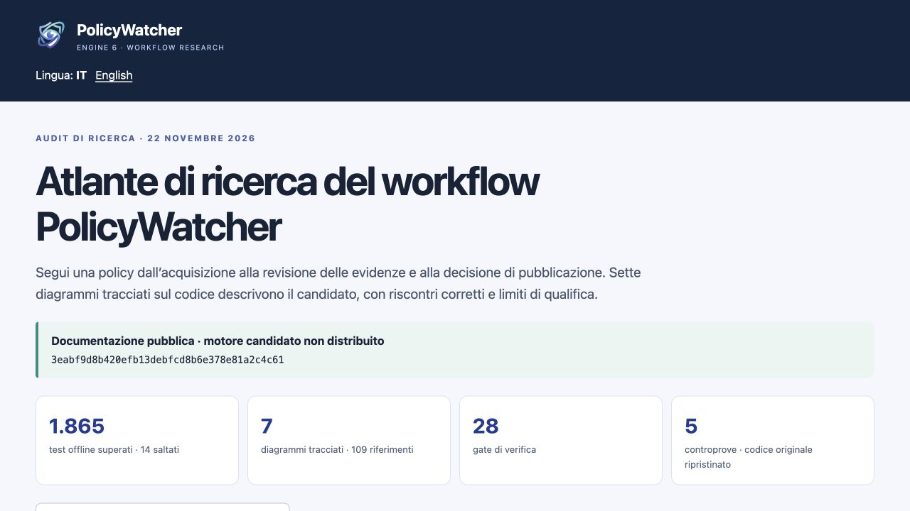

# Publicazione cumulativa del workflow: 23 novembre 2026

**Pubblicato e verificato sul dominio ufficiale.** Il pacchetto 5.6 preparato il 22 novembre è stato distribuito il 23 novembre alle 00:15 Europe/Rome. Il sito pubblico conserva lo scanner stabile; il codice candidato Engine 6 `3eabf9d` viene documentato, non attivato. La PR#84 rimane aperta e non integrata.

## Unico archivio Hostinger

`PolicyWatcher-5.6.0-hostinger-2026-11-22-workflow-audit-atlas-cumulative.zip`

SHA 256: `34fff71682d318d4df9a8bec800bcb51ab984080ae8ecf31ad7a97d4cb4ec2bc`.

Fonte immutabile: `31cb963c425be64a308a992a828ac45f43ec2e7b`, ramo `codex/release-56-completeness-public`. Il commit di questa ricevuta è successivo e non cambia il pacchetto distribuito. Gli archivi precedenti sono conservati come storia e superati per questa consegna.

## Cosa è disponibile

- [Diario e audit IT](https://policywatcher.online/engine-6-preview?lang=it#validation), [EN](https://policywatcher.online/engine-6-preview#validation).
- [Indice dell’atlante IT](https://policywatcher.online/research/engine-workflow-20261122/index-it.html), [EN](https://policywatcher.online/research/engine-workflow-20261122/index.html), leggibili senza JavaScript.
- [Atlante interattivo originale italiano](https://policywatcher.online/engine-6-preview/workflow?lang=it), servito con ilnonce del proxy senza allentare laCSP.
- [Diagrammi e ricevute scaricabili](https://policywatcher.online/research/engine-workflow-20261122/workflow-audit-evidence.zip). Questo ZIP documentale non è l’archivio applicativo Hostinger.

Sette diagrammi tecnici mantengono le etichette inglesi revisionate; panoramica e originale interattivo sono esplicitamente italiani. Sono inclusi sette sorgenti Mermaid, otto SVG, PNG, modello, matrice 28 gate e 109 riferimenti, rapporto e ricevute. Le pagine EN/IT Preview, metodo, Atlas, Feature Atlas, roadmap, changelog/newsroom, feed, sitemap e llms.txt rimandano allo stesso registro di ricerca. La nuova route è di sola lettura e legge un solo artefatto pubblico fisso.

## Prove e sequenza reale

1. Copia dell’esatto ZIP e installazione delle dipendenze del lockfile: Next 16.4.6. Build completa passata; 35 test di contenuto e controlli lint passati. Database locale isolato con 35 tabelle e 19 migrazioni. Trentasette controlli HTTP locali, dieci schede interattive, reload delle ancore, tastiera e cambio EN/IT verificati. A 390 px nessun overflow del documento.
2. Staging `01a2055f-7f35-7303-a07b-c90ffa635513`: completato il 22 novembre alle 23:30. Passati 37 controlli HTTP e 12 operativi; 1.128 file sorgente corrispondono allo ZIP. È stato osservato un ulteriore deployment dello stesso contenuto alle 23:57, dopo il rinnovo del collegamento browser; la sua origine non è attribuita e le impronte sono state nuovamente verificate.
3. Preview r3 originale ripristinata: `01a20583-7de2-7247-a7b6-2594e2489595`, completata il 23 novembre alle 00:10. Archivio originale SHA 256 `e82ff8ff3fe33275e62475054889cdaf97f1a12d7442bb0ca6d42ec30cf99341`; identità motore `84085328fffc7b22fac33cc2cbe150120c540b75deda59d3b207c32b768a9a00`. Passati 14 controlli autenticati e 1.090 confronti dei file sorgente; 14 hash protetti e 3 rapporti invariati, zero task attivi, 47 tabelle/22 migrazioni. Pubblicazione e notifiche disabilitate. Questo non dimostra continuità durante la manutenzione temporanea.
4. Produzione `01a20587-f898-71da-a5af-3201e785a870`, completata e corrente alle 00:15 del 23 novembre: 37 controlli HTTP, 53 asset pubblici con hash corrispondente, 1.128 file sorgente uguali all’archivio. Le due directory di ritenzione sono alias dello stesso controllo, non 2.256 file distinti. Nove controlli operativi interni superati; resta un controllo indipendente esterno, quindi lo stato aggregato è attention. Nessun pentest viene dichiarato.
5. Il database pubblico conserva le 35 tabelle applicative richieste, più la tabella ausiliaria preesistente `CorrectionCase`: 36 tabelle effettive e 19 migrazioni, integrità ok. Tutte sono conservate. Cambia soltanto `AdminAccessLog` per gli accessi delle verifiche; i dati delle altre 35 tabelle, inclusa `CorrectionCase`, hanno hash invariati. Copie di sicurezza e ricevute grezze private restano fuori da Git e dall’archivio.

Le prove di build, le risposte HTTP e i test del candidato sono denominatori diversi. I 1.865 test/14 saltati e i sei check GitHub appartengono al candidato `3eabf9d`/documentazione `caffc1a`; non sono nuove policy qualificate o check CI attribuiti a questa distribuzione pubblica.

## Correzioni della consegna e limiti

Sono conservati gli insuccessi intermedi, dettagliati in [receipt.json](receipt.json): dipendenze clonate non allineate al lockfile, primo artefatto non congelato, link secondario senza nonce e ancore risolte rispetto al base. I controlli sono stati mantenuti; il pacchetto valido è stato ricostruito e verificato prima del rilascio. La prima verifica locale del manifesto, priva dell’identità proxy richiesta, ha ricevuto 503; il manifesto sul servizio ospitato ha poi confermato 5.6.0.

La Preview storica è stata ripristinata esattamente come richiesto. Il suo install registra quattro avvisi dipendenze npm, uno moderato e tre alti, da trattare in una manutenzione separata con nuova identità e qualifica; questa consegna non li risolve né certifica la sicurezza. Il pacchetto pubblico 5.6 usa Next 16.4.6; i relativi log di installazione in staging riportano zero avvisi npm. Gli avvisi non vengono equiparati a un attacco dimostrato.

Completezza indipendente delle fonti, accuratezza semantica generale e 500 completamenti giornalieri dell’intera pipeline restano non qualificati. Nessuna nuova scansione, cattura live, inferenza o giornata di osservazione è stata eseguita. Nessun nuovo verdetto Gemini o GLM 5.3 MAX è attribuito a questa pubblicazione. La coorte congelata e l’implementazione ospitata non ereditano le prove del candidato locale.

